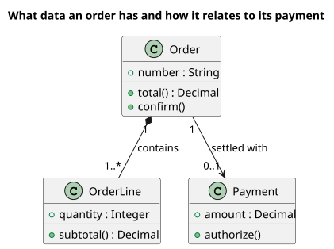

<p align="right">Idioma:&emsp;<a href="README.md" style="vertical-align:middle"></a> </p>

# UML Diagrams (`plugin-uml-diagrams`)

Dibuja diagramas UML 1.5 y UML 2.5.1 para cualquier rol. Cada pedido usa la notación de la versión que se pidió.

Cada diagrama está documentado en `skills/generate-diagram/references/`. Cada página tiene el diagrama fácil de leer, la notación, la plantilla, un ejemplo PlantUML y tres formas de pedirlo: un comando corto, un comando que fija el contenido y una frase. Las plantillas viven en `skills/generate-diagram/assets/`.

## Para quién es

Quien necesita una vista UML dentro de una conversación con el agente: arquitectura, casos de uso, pruebas o interfaz. Esos roles le piden el dibujo a este plugin. No copian sus skills.

## Qué incluye

Portable, para cualquier agente que siga [Agent Skills](https://agentskills.io/specification):

- Skill [generate-diagram](skills/generate-diagram/SKILL.es.md), con una referencia y una plantilla PlantUML por cada diagrama del catálogo (9 de UML 1 y 14 de UML 2). El skill también lleva los límites de notación y la carpeta de salida, para que un agente sin rules los conserve.

Cursor y Claude Code:

- 24 comandos: `/uml-help` (catálogo de una línea de skills, rules y comandos) y un comando por diagrama. En Cursor, `/uml-help` o `/uml-sequence-v2`. En Claude Code, `/plugin-uml-diagrams:uml-help`.

Solo Cursor:

- Rule `uml-notation`, que impide mezclar las dos notaciones.
- Rule `output-folder`, que guarda cada diagrama dentro de la carpeta de salida.

## Instalación

En Cursor, instala el plugin desde este repositorio en Customize.

En Claude Code, este repositorio también es un marketplace:

```text
claude plugin marketplace add ADRenaline-Suite/plugin-uml-diagrams
claude plugin install plugin-uml-diagrams@plugin-uml-diagrams
```

Para probar una copia local sin instalarla, arranca Claude Code con `claude --plugin-dir <path to this repository>`.

En otro agente, instala el skill con el mecanismo de ese agente. Por ejemplo:

```text
gh skill install ADRenaline-Suite/plugin-uml-diagrams
```

## Configuración

No usa variables ni servicios. El render es PlantUML.

Cada diagrama se guarda en la raíz del proyecto como dos archivos: la fuente `uml-diagrams/<NNN>-<id>-<topic>.puml` y la imagen `uml-diagrams/<NNN>-<id>-<topic>.svg`, con un `<NNN>` monótono que no se reutiliza. La carpeta también lleva `STATUS.md` (`proposed` | `accepted` | `deprecated` | `superseded`); si hay varias versiones, manda `accepted`. El SVG necesita `plantuml` en el PATH, `java -jar plantuml.jar`, o Docker con la imagen `plantuml/plantuml`. Sin ninguno de los tres, solo se guarda el `.puml` y la entrega da el comando para renderizarlo.

Los diagramas de clases, secuencia y estados también reciben `uml-diagrams/<NNN>-<id>-<topic>.md` con el mismo diagrama en Mermaid, que GitHub, GitLab y Azure DevOps renderizan sin herramientas. Los otros tipos no tienen equivalente nativo en Mermaid, así que no reciben ese archivo. Las reglas están en [references/mermaid.md](skills/generate-diagram/references/mermaid.es.md).

Para usar otra carpeta, agrega `.cursor/adrenaline.json` al proyecto:

```json
{
  "outputDirs": {
    "plugin-uml-diagrams": "docs/uml"
  }
}
```

La ruta es relativa a la raíz del proyecto y no puede contener `..`. Claude Code y los demás agentes leen el mismo archivo.

## Cómo pedirlo

Antes de cerrar, el comando revisa la lista de terminado de `generate-diagram` y la de ese diagrama. Un archivo que falla una comprobación se corrige en el mismo turno, o no se marca `accepted`.

Si un nombre de comando no es familiar, lee [Para qué sirve cada comando](#para-qué-sirve-cada-comando) antes del catálogo.

En Cursor, `/uml-sequence-v2` o el nombre de otro comando. En Claude Code, el mismo nombre con el prefijo del plugin: `/plugin-uml-diagrams:uml-sequence-v2`. Pedir el diagrama en lenguaje natural basta: el skill elige la referencia.

Para guardar un diagrama que el agente ya mostró en la conversación, pide guardarlo. Se guarda como se mostró, con los mismos participantes y ramas. La guía de legibilidad de cada referencia solo aplica cuando dejas el contenido abierto; si el diagrama se pasa de esa guía, la entrega lo dice y sugiere partirlo, pero no corta nada salvo que lo pidas.

El render es PlantUML. Comunicación, colaboración, estructura compuesta, perfiles y vista general de interacción no tienen tipo nativo en PlantUML: la referencia dice la aproximación, y la entrega también.

Cada referencia incluye el SVG renderizado junto a su fuente. Este es el diagrama de clases UML 2:



## Para qué sirve cada comando

No hace falta saber UML. Cada comando dibuja una imagen que responde una pregunta sobre un sistema. El nombre después de `/uml-` es el tipo de imagen. `v1` es la notación anterior (UML 1.5). `v2` es la actual (UML 2.5.1). Si nadie pidió la notación vieja, usa `v2`.

Hay un solo skill, [generate-diagram](skills/generate-diagram/SKILL.es.md). Es la parte que dibuja. No hace falta nombrarlo: un comando ya lo elige. Si describes la imagen en una frase en lugar de usar un comando, ese skill elige el manual que corresponde.

### `/uml-help`

Imprime la lista de este plugin: el skill, las rules y cada comando, cada uno en una frase. No dibuja un diagrama y no guarda un archivo. Úsalo cuando quieras ver qué puedes pedir.

### `/uml-classes-v1`

Dibuja un diagrama de clases en la notación anterior. Un diagrama de clases es un mapa de las ideas de un sistema — un pedido, un cliente, un pago — y las líneas que dicen cómo dependen unas de otras. Cada caja puede listar los datos que guarda y las acciones que puede hacer. Úsalo cuando el equipo necesita ponerse de acuerdo en esas ideas antes de construir, y un documento ya usa UML 1.

### `/uml-classes-v2`

Dibuja el mismo tipo de mapa que `/uml-classes-v1`: las ideas y cómo se relacionan, en la notación actual. Usa este salvo que alguien haya pedido UML 1.

### `/uml-objects-v1`

Dibuja un diagrama de objetos en la notación anterior. Donde un diagrama de clases muestra las ideas en general, este muestra una instantánea: los valores reales en un momento (este pedido, este cliente, este monto). Úsalo cuando un ejemplo concreto explica el modelo mejor que el mapa general, y el documento debe quedarse en UML 1.

### `/uml-objects-v2`

Dibuja la misma instantánea que `/uml-objects-v1`, en la notación actual. Úsalo para mostrar un ejemplo concreto de las ideas de un diagrama de clases.

### `/uml-use-cases-v1`

Dibuja un diagrama de casos de uso en la notación anterior. Muestra quién usa el sistema (una persona u otro sistema) y para qué lo usa, como pagar, cancelar o consultar un pedido. No describe los pasos dentro de cada meta. Úsalo cuando necesitas el límite del sistema, y el archivo debe usar UML 1.

### `/uml-use-cases-v2`

Dibuja la misma imagen que `/uml-use-cases-v1` — quién usa el sistema y para qué — en la notación actual. El relato escrito de cada meta no es este diagrama. Ese texto pertenece a `plugin-project-manager`.

### `/uml-sequence-v1`

Dibuja un diagrama de secuencia en la notación anterior. Muestra quién habla con quién, y en qué orden, a lo largo del tiempo: el cliente pide pagar, la tienda le pide al banco, el banco responde. No puede dibujar una rama como «si el banco dice que no». Si la historia tiene alternativas, este comando las parte en imágenes separadas. Úsalo para una conversación recta, en UML 1.

### `/uml-sequence-v2`

Dibuja la misma conversación en el tiempo que `/uml-sequence-v1`, en la notación actual. Este también puede mostrar ramas y repeticiones, como que el banco diga que sí o que no, o un paso que se repite. Úsalo cuando la pregunta es el orden de los mensajes.

### `/uml-collaboration-v1`

Dibuja un diagrama de colaboración, que solo existe en UML 1. Muestra la misma conversación que un diagrama de secuencia, dibujada como un mapa de quién está conectado, con números en los mensajes para el orden. Úsalo cuando esos vínculos importan y se exige un documento UML 1. En UML 2 la misma imagen es `/uml-communication-v2`.

### `/uml-communication-v2`

Dibuja un diagrama de comunicación. Es la misma idea que `/uml-collaboration-v1`: quién está enlazado, y en qué orden numerado van los mensajes. Este es el nombre actual de esa imagen. Úsalo cuando los vínculos importan más que una línea de tiempo de arriba abajo.

### `/uml-states-v1`

Dibuja un statechart, el nombre UML 1 de la vida de una cosa. Las cajas son situaciones, como un pedido que está nuevo, pagado, enviado o cancelado, y las flechas son lo que lo hace cambiar. Úsalo cuando necesitas esa vida en notación UML 1. En UML 2 la misma imagen es `/uml-state-machine-v2`.

### `/uml-state-machine-v2`

Dibuja una máquina de estados: la vida de una cosa, del inicio al fin, y qué la mueve de una situación a la siguiente. Úsalo cuando la pregunta es en qué puede convertirse esta cosa, y cuándo, en la notación actual.

### `/uml-activities-v1`

Dibuja un grafo de actividades, la imagen UML 1 de un procedimiento: los pasos, las decisiones y dónde el trabajo se parte o se junta. No usa la notación más nueva de tokens y pins. Úsalo para un procedimiento que debe quedarse en UML 1.

### `/uml-activities-v2`

Dibuja un diagrama de actividades: cómo avanza un procedimiento, incluida la notación actual del trabajo que se parte, espera y se junta. Úsalo cuando la pregunta son los pasos de un proceso. Quién envía qué mensaje es un diagrama de secuencia, no este.

### `/uml-components-v1`

Dibuja un diagrama de componentes en la notación anterior. Un componente es una pieza de software que se puede cambiar o entregar sola, como facturación o inicio de sesión, y las líneas muestran cómo se enchufan esas piezas. Esta versión no dibuja puertos. Úsalo cuando la pregunta es qué piezas de software existen, en UML 1.

### `/uml-components-v2`

Dibuja el mismo ensamble de piezas de software que `/uml-components-v1`, en la notación actual, que también puede mostrar los enchufes (puertos) y los cables entre ellos. Úsalo cuando necesitas ver cómo se conectan las partes del software.

### `/uml-deployment-v1`

Dibuja un diagrama de despliegue en la notación anterior. Muestra dónde vive el software: qué programa corre en qué máquina, servidor o dispositivo. Úsalo cuando la pregunta es la instalación, y el archivo debe usar UML 1.

### `/uml-deployment-v2`

Dibuja la misma imagen que `/uml-deployment-v1` — dónde está instalado el software — en la notación actual. Úsalo para ponerse de acuerdo en servidores, dispositivos y qué corre en cada uno.

### `/uml-packages-v2`

Dibuja un diagrama de paquetes. Un paquete es una carpeta del modelo: una forma de agrupar clases u otras piezas para que un modelo grande se lea por partes, y de mostrar qué grupo depende de cuál. Esta imagen solo existe en UML 2. Úsalo cuando el modelo es demasiado grande para verse como una lista plana.

### `/uml-composite-v2`

Dibuja un diagrama de estructura compuesta. Abre una pieza y muestra las partes de adentro y cómo se conectan, como un pago hecho de un carrito, una revisión de precio y un cobro. Esta imagen solo existe en UML 2. Úsalo cuando la pregunta es el interior de una pieza. El mapa de todas las ideas es un diagrama de clases, no este.

### `/uml-profiles-v2`

Dibuja un diagrama de perfiles. Un perfil es una forma de extender el propio UML con etiquetas extra de un dominio, por ejemplo marcar una clase como servicio. Esta imagen solo existe en UML 2. Úsalo cuando estás definiendo esa extensión. No dibuja el sistema.

### `/uml-timing-v2`

Dibuja un diagrama de tiempos. Muestra cuándo una cosa cambia de situación a lo largo de un reloj: cuánto permanece en cada una, y qué está haciendo en un momento dado. Esta imagen solo existe en UML 2. Úsalo cuando la pregunta es la duración. La lista de situaciones, sin el reloj, es una máquina de estados.

### `/uml-interaction-overview-v2`

Dibuja una vista general de interacción. Es un mapa de varios escenarios y el orden en que corren: primero esta conversación, luego aquella, y una decisión entre ellas. Cada escenario suele ser un diagrama de secuencia. Esta imagen solo existe en UML 2. Úsalo cuando ya tienes varias conversaciones y necesitas mostrar cómo encajan.

## Catálogo

| Diagrama | Acción | Documentación |
| --- | --- | --- |
| Diagrama de clases UML 1 | `/uml-classes-v1` | [referencia](skills/generate-diagram/references/classes-v1.es.md) |
| Diagrama de clases UML 2 | `/uml-classes-v2` | [referencia](skills/generate-diagram/references/classes-v2.es.md) |
| Diagrama de objetos UML 1 | `/uml-objects-v1` | [referencia](skills/generate-diagram/references/objects-v1.es.md) |
| Diagrama de objetos UML 2 | `/uml-objects-v2` | [referencia](skills/generate-diagram/references/objects-v2.es.md) |
| Diagrama de casos de uso UML 1 | `/uml-use-cases-v1` | [referencia](skills/generate-diagram/references/use-cases-v1.es.md) |
| Diagrama de casos de uso UML 2 | `/uml-use-cases-v2` | [referencia](skills/generate-diagram/references/use-cases-v2.es.md) |
| Diagrama de secuencia UML 1 | `/uml-sequence-v1` | [referencia](skills/generate-diagram/references/sequence-v1.es.md) |
| Diagrama de secuencia UML 2 | `/uml-sequence-v2` | [referencia](skills/generate-diagram/references/sequence-v2.es.md) |
| Diagrama de colaboración UML 1 | `/uml-collaboration-v1` | [referencia](skills/generate-diagram/references/collaboration-v1.es.md) |
| Diagrama de estados UML 1 | `/uml-states-v1` | [referencia](skills/generate-diagram/references/states-v1.es.md) |
| Grafo de actividades UML 1 | `/uml-activities-v1` | [referencia](skills/generate-diagram/references/activities-v1.es.md) |
| Diagrama de componentes UML 1 | `/uml-components-v1` | [referencia](skills/generate-diagram/references/components-v1.es.md) |
| Diagrama de despliegue UML 1 | `/uml-deployment-v1` | [referencia](skills/generate-diagram/references/deployment-v1.es.md) |
| Diagrama de paquetes UML 2 | `/uml-packages-v2` | [referencia](skills/generate-diagram/references/packages-v2.es.md) |
| Diagrama de estructura compuesta UML 2 | `/uml-composite-v2` | [referencia](skills/generate-diagram/references/composite-v2.es.md) |
| Diagrama de componentes UML 2 | `/uml-components-v2` | [referencia](skills/generate-diagram/references/components-v2.es.md) |
| Diagrama de despliegue UML 2 | `/uml-deployment-v2` | [referencia](skills/generate-diagram/references/deployment-v2.es.md) |
| Diagrama de perfiles UML 2 | `/uml-profiles-v2` | [referencia](skills/generate-diagram/references/profiles-v2.es.md) |
| Diagrama de actividades UML 2 | `/uml-activities-v2` | [referencia](skills/generate-diagram/references/activities-v2.es.md) |
| Diagrama de máquina de estados UML 2 | `/uml-state-machine-v2` | [referencia](skills/generate-diagram/references/state-machine-v2.es.md) |
| Diagrama de comunicación UML 2 | `/uml-communication-v2` | [referencia](skills/generate-diagram/references/communication-v2.es.md) |
| Diagrama de tiempos UML 2 | `/uml-timing-v2` | [referencia](skills/generate-diagram/references/timing-v2.es.md) |
| Diagrama de vista general de interacción UML 2 | `/uml-interaction-overview-v2` | [referencia](skills/generate-diagram/references/interaction-overview-v2.es.md) |

## Licencia

MIT. Ver [LICENSE](LICENSE).
