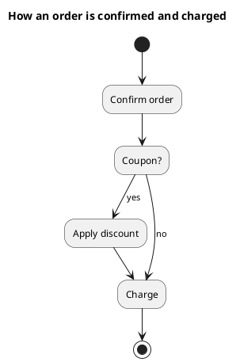

<p align="right">Idioma:&emsp;<a href="activities-v1.md" style="vertical-align:middle"></a> </p>

[🏠 UML Diagrams](../../../README.es.md) / [Generar un diagrama UML](../SKILL.es.md)

# Grafo de actividades UML 1

Fuente: OMG UML 1.4 y 1.5. En los puntos de conformidad de UML 1.4 figura como grafo de actividades.

## Pregunta que responde

En qué orden ocurren los pasos de un procedimiento, y dónde se ramifica.

## Diagrama fácil de leer

Una guía para elegir qué dibujar cuando la persona lo deja abierto. Nunca quita lo que la persona pidió o aprobó (ver Fidelidad en el skill).

Un estado inicial, acciones como estados, una decisión con las dos salidas etiquetadas y un estado final. Carriles solo cuando hay dos dueños claros.

## Notación de esta versión

- Estados de acción y transiciones, porque en UML 1 una actividad es una forma de máquina de estados.
- Una decisión son transiciones con guardas, no un nodo de control suelto.
- Sin pins, nodos de objeto ni flujo de tokens. Eso es UML 2.
- La concurrencia de UML 1, cuando hace falta, es un par fork/join, no varios flujos de tokens.

## Renderizado

PlantUML dibuja el grafo con la sintaxis antigua `(*)` y acciones entre comillas. Esa es la sintaxis de este pedido, no `start` / `if` / `stop`.

## Plantilla

`../assets/activities-v1.puml`. Sustituye los nombres del dominio y conserva la forma.

## Ejemplo




## Ejemplos

Comando corto. El comando ya fija el diagrama, así que bastan unas palabras del dominio. El agente completa lo que dejas abierto.

```text
/uml-activities-v1 Confirm and charge an order.
```

Comando. Fija el diagrama. El resto es el dominio.

```text
/uml-activities-v1 Confirm and charge. If there is a coupon the discount is applied, and in both cases the order is charged. Use action-state syntax, not UML 2 token syntax.
```

Frase. La oración nombra el diagrama, y el skill elige esta referencia.

```text
Draw a UML 1 activity graph to confirm and charge: if there is a coupon the discount is applied, and in both cases the order is charged. Use action-state syntax, not UML 2 token syntax.
```

## Terminado

- El dibujo responde en qué orden ocurren los pasos de un procedimiento, y dónde se ramifica. El título enuncia esa pregunta.
- La fuente usa estados de acción, transiciones y la sintaxis `(*)` con acciones entre comillas. No usa `start`, `if` ni `stop`. No hay pins, nodos de objeto ni flujo de tokens. Una decisión son transiciones con guarda, no un nodo de control suelto.
- Cada elemento que la persona pidió o aprobó está en la fuente. La guía añadió algo solo donde la persona lo dejó abierto, y la línea Guide lo dice.
- El renderizado usa esa sintaxis `(*)`. La entrega no llama grafo v1 a una actividad de UML 2.
