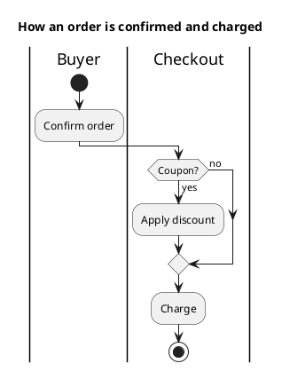

<p align="right">Idioma:&emsp;<a href="activities-v2.md" style="vertical-align:middle"></a> </p>

[🏠 UML Diagrams](../../../README.es.md) / [Generar un diagrama UML](../SKILL.es.md)

# Diagrama de actividades UML 2

Fuente: OMG UML 2.5.1, anexo A, diagrama de actividades. Semántica de flujo de tokens.

## Pregunta que responde

Cómo avanza un procedimiento, quién lo hace y dónde decide.

## Diagrama fácil de leer

Guía para elegir qué dibujar cuando quien pide lo deja abierto. Nunca quita lo que pidió o aprobó (véase Fidelidad en el skill).

Carriles con el responsable, un nodo inicial, acciones, una decisión con las dos salidas etiquetadas y un nodo final. Una bifurcación/unión solo cuando hay trabajo paralelo de verdad.

## Notación de esta versión

- Nodos de acción, nodo inicial, final de actividad, decisión y fusión.
- Flujo de control. Flujo de objetos y pins solo cuando el dato es la pregunta.
- Particiones (carriles) para el responsable.
- Esto no es el grafo de actividades de UML 1: aquí una actividad no es una máquina de estados.

## Renderizado

PlantUML dibuja este diagrama de forma nativa con `start`, acciones, `if` y `stop`.

## Plantilla

`../assets/activities-v2.puml`. Sustituye los nombres del dominio y conserva la forma.

## Ejemplo




## Ejemplos

Comando corto. El comando ya fija el diagrama, así que bastan unas palabras del dominio. El agente completa lo que dejas abierto.

```text
/uml-activities-v2 Confirm and charge an order.
```

Comando. Fija el diagrama. El resto es el dominio.

```text
/uml-activities-v2 The buyer confirms the order and checkout, if there is a coupon, applies the discount, and in both cases charges.
```

Frase. La oración nombra el diagrama y el skill elige esta referencia.

```text
Draw a UML 2 activity diagram with swimlanes: the buyer confirms the order and checkout, if there is a coupon, applies the discount, and in both cases charges.
```

## Terminado

- El dibujo responde cómo avanza un procedimiento, quién lo hace y dónde decide. El título enuncia esa pregunta.
- La fuente usa `start`, acciones, `if` y `stop`. No es un grafo de actividades de UML 1. El flujo de objetos y los pins aparecen solo cuando el dato es la pregunta.
- Cada elemento que se pidió o se aprobó está en la fuente. La guía añadió algo solo donde se dejó abierto, y la línea `Guide` lo dice.
- El render es PlantUML nativo. La entrega no lo llama aproximación.
