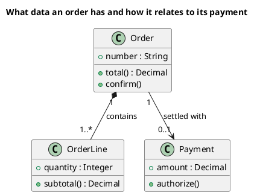

<p align="right">Idioma:&emsp;<a href="classes-v1.md" style="vertical-align:middle"></a> </p>

[🏠 UML Diagrams](../../../README.es.md) / [Generar un diagrama UML](../SKILL.es.md)

# Diagrama de clases UML 1

Fuente: OMG UML 1.5, diagrama de clases.

## Pregunta que responde

Qué conceptos existen y cómo se relacionan, en notación de clases de UML 1.

## Diagrama fácil de leer

Una guía para elegir qué dibujar cuando la persona lo deja abierto. Nunca quita lo que la persona pidió o aprobó (ver Fidelidad en el skill).

De tres a seis cajas con tres compartimentos. Asociaciones con multiplicidad y un verbo como nombre. Como mucho una generalización. Agregación o composición solo cuando el todo y la parte son la pregunta.

## Notación de esta versión

- Una caja con nombre, atributos y operaciones.
- Asociación, agregación (rombo hueco), composición (rombo relleno), dependencia y generalización.
- Multiplicidad en los extremos.
- Esta versión no pone puertos ni partes internas en la clase. Eso es la estructura compuesta de UML 2.

## Renderizado

PlantUML dibuja este diagrama de forma nativa.

## Plantilla

`../assets/classes-v1.puml`. Sustituye los nombres del dominio y conserva la forma.

## Ejemplo




## Ejemplos

Comando corto. El comando ya fija el diagrama, así que bastan unas palabras del dominio. El agente completa lo que dejas abierto.

```text
/uml-classes-v1 A sales cart.
```

Comando. Fija el diagrama. El resto es el dominio.

```text
/uml-classes-v1 An order contains one or more lines and is settled with an optional payment. Show only number, total, quantity, subtotal, and amount, and the operations confirm, subtotal, and authorize.
```

Frase. La oración nombra el diagrama, y el skill elige esta referencia.

```text
Draw a UML 1 class diagram of an order: an order contains one or more lines and is settled with an optional payment. Show only number, total, quantity, subtotal, and amount, and the operations confirm, subtotal, and authorize.
```

## Terminado

- El dibujo responde qué conceptos existen y cómo se relacionan, en notación de clases de UML 1. El título enuncia esa pregunta.
- La notación es solo clases de UML 1: cajas con nombre, atributos y operaciones; asociación, agregación, composición, dependencia y generalización; multiplicidad en los extremos. No hay puertos ni partes internas.
- Cada elemento que la persona pidió o aprobó está en la fuente. La guía añadió algo solo donde la persona lo dejó abierto, y la línea Guide lo dice.
- El renderizado es PlantUML nativo. La entrega no lo llama aproximación.
