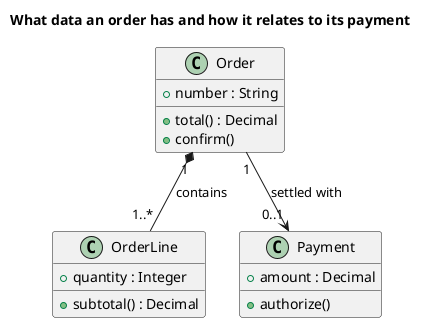

<p align="right">Language:&emsp; <a href="classes-v1.es.md" style="vertical-align:middle"></a></p>

[🏠 UML Diagrams](../../../README.md) / [Generate a UML diagram](../SKILL.md)

# UML 1 class diagram

Source: OMG UML 1.5, class diagram.

## Question it answers

What concepts exist and how they relate, in UML 1 class notation.

## Diagram that is easy to read

A guide for choosing what to draw when the user leaves it open. It never removes what the user asked for or approved (see Fidelity in the skill).

Three to six boxes with three compartments. Associations with multiplicity and a verb as the name. At most one generalization. Aggregation or composition only when the whole and the part are the question.

## Notation for this version

- A box with a name, attributes, and operations.
- Association, aggregation (hollow diamond), composition (filled diamond), dependency, and generalization.
- Multiplicity on the ends.
- This version does not put ports or internal parts on the class. That is UML 2 composite structure.

## Render

PlantUML draws this diagram natively.

## Template

`../assets/classes-v1.puml`. Replace the domain names and keep the shape.

## Example




## Examples

Short command. The command already fixes the diagram, so a few words of domain are enough. The agent fills in what you leave open.

```text
/uml-classes-v1 A sales cart.
```

Command. It fixes the diagram. The rest is the domain.

```text
/uml-classes-v1 An order contains one or more lines and is settled with an optional payment. Show only number, total, quantity, subtotal, and amount, and the operations confirm, subtotal, and authorize.
```

Prompt. The sentence names the diagram, and the skill chooses this reference.

```text
Draw a UML 1 class diagram of an order: an order contains one or more lines and is settled with an optional payment. Show only number, total, quantity, subtotal, and amount, and the operations confirm, subtotal, and authorize.
```

## Done

- The drawing answers what concepts exist and how they relate, in UML 1 class notation. The title states that question.
- Notation is only UML 1 class: boxes with name, attributes, and operations; association, aggregation, composition, dependency, and generalization; multiplicity on the ends. Ports and internal parts are absent.
- Every element the user asked for or approved is in the source. The guide added something only where the user left it open, and the Guide line says so.
- Render is native PlantUML. The delivery does not call it an approximation.
