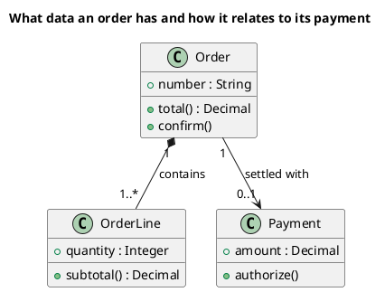

<p align="right">Idioma:&emsp;<a href="classes-v2.md" style="vertical-align:middle"></a> </p>

[🏠 UML Diagrams](../../../README.es.md) / [Generar un diagrama UML](../SKILL.es.md)

# Diagrama de clases UML 2

Fuente: OMG UML 2.5.1, anexo A, diagrama de clases.

## Pregunta que responde

Qué conceptos existen y cómo se relacionan.

## Diagrama fácil de leer

Guía para elegir qué dibujar cuando quien pide lo deja abierto. Nunca quita lo que pidió o aprobó (véase Fidelidad en el skill).

De tres a seis cajas con tres compartimentos. Asociaciones con multiplicidad y un verbo. Como mucho una generalización. Un rombo relleno solo si la parte no sobrevive sin el todo.

## Notación de esta versión

- Una caja con nombre, atributos y operaciones.
- Asociación, agregación, composición, dependencia, generalización y realización.
- Multiplicidad y rol en los extremos cuando cambian la lectura.
- Los puertos y las partes internas pertenecen a un diagrama de estructura compuesta, no a este.

## Renderizado

PlantUML dibuja este diagrama de forma nativa.

## Plantilla

`../assets/classes-v2.puml`. Sustituye los nombres del dominio y conserva la forma.

## Ejemplo




## Ejemplos

Comando corto. El comando ya fija el diagrama, así que bastan unas palabras del dominio. El agente completa lo que dejas abierto.

```text
/uml-classes-v2 A sales cart.
```

Comando. Fija el diagrama. El resto es el dominio.

```text
/uml-classes-v2 An order: composition with order lines and an optional association with the payment. Only the attributes and operations needed to read the total and authorize the payment.
```

Frase. La oración nombra el diagrama y el skill elige esta referencia.

```text
Draw a UML 2 class diagram of an order: composition with order lines and an optional association with the payment. Only the attributes and operations needed to read the total and authorize the payment.
```

## Terminado

- El dibujo responde qué conceptos existen y cómo se relacionan. El título enuncia esa pregunta.
- La notación es solo la de clases de UML 2: cajas con nombre, atributos y operaciones; asociación, agregación, composición, dependencia, generalización y realización; multiplicidad y rol cuando cambian la lectura. No hay puertos ni partes internas.
- Cada elemento que se pidió o se aprobó está en la fuente. La guía añadió algo solo donde se dejó abierto, y la línea `Guide` lo dice.
- El render es PlantUML nativo. La entrega no lo llama aproximación.
