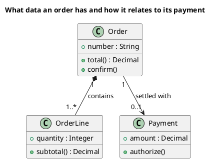

[🏠 UML Diagrams](../../../README.md) / [Generate a UML diagram](../SKILL.md)

# UML 2 class diagram

Source: OMG UML 2.5.1, Annex A, class diagram.

## Question it answers

What concepts exist and how they relate.

## Diagram that is easy to read

A guide for choosing what to draw when the user leaves it open. It never removes what the user asked for or approved (see Fidelity in the skill).

Three to six boxes with three compartments. Associations with multiplicity and a verb. At most one generalization. A filled diamond only if the part does not survive without the whole.

## Notation for this version

- A box with a name, attributes, and operations.
- Association, aggregation, composition, dependency, generalization, and realization.
- Multiplicity and role on the ends when they change the reading.
- Ports and internal parts belong on a composite structure diagram, not here.

## Render

PlantUML draws this diagram natively.

## Template

`../assets/classes-v2.puml`. Replace the domain names and keep the shape.

## Example




## Examples

Short command. The command already fixes the diagram, so a few words of domain are enough. The agent fills in what you leave open.

```text
/uml-classes-v2 A sales cart.
```

Command. It fixes the diagram. The rest is the domain.

```text
/uml-classes-v2 An order: composition with order lines and an optional association with the payment. Only the attributes and operations needed to read the total and authorize the payment.
```

Prompt. The sentence names the diagram, and the skill chooses this reference.

```text
Draw a UML 2 class diagram of an order: composition with order lines and an optional association with the payment. Only the attributes and operations needed to read the total and authorize the payment.
```

## Done

- The drawing answers what concepts exist and how they relate. The title states that question.
- Notation is only UML 2 class: boxes with name, attributes, and operations; association, aggregation, composition, dependency, generalization, and realization; multiplicity and role when they change the reading. Ports and internal parts are absent.
- Every element the user asked for or approved is in the source. The guide added something only where the user left it open, and the Guide line says so.
- Render is native PlantUML. The delivery does not call it an approximation.
