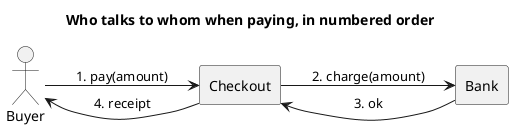
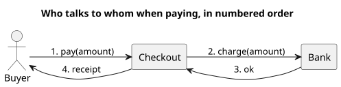

<p align="right">Idioma:&emsp;<a href="collaboration-v1.md" style="vertical-align:middle"></a> </p>

[🏠 UML Diagrams](../../../README.es.md) / [Generar un diagrama UML](../SKILL.es.md)

# Diagrama de colaboración UML 1

Fuente: OMG UML 1.5, diagrama de colaboración. En UML 2 este diagrama se llama comunicación.

## Pregunta que responde

Quién está conectado con quién, y en qué orden se envían los mensajes.

## Diagrama fácil de leer

Una guía para elegir qué dibujar cuando la persona lo deja abierto. Nunca quita lo que la persona pidió o aprobó (ver Fidelidad en el skill).

De tres a cinco nodos en horizontal, con mensajes numerados 1, 2, 3 en los enlaces. El número es el orden. Elígelo cuando la red de enlaces importa más que la columna de tiempo.

## Notación de esta versión

- Objetos o roles unidos por enlaces.
- Mensajes con un número de secuencia junto al enlace.
- Sin fragmentos combinados.
- El nombre UML 2 de este diagrama es comunicación. Un pedido v1 usa este nombre.

## Renderizado

PlantUML no tiene un diagrama de colaboración de primera clase (sigue siendo una petición abierta de PlantUML). La entrega usa un grafo con mensajes numerados y lo declara como una aproximación de disposición, no como un marco de colaboración nativo.

## Plantilla

`../assets/collaboration-v1.puml`. Sustituye los nombres del dominio y conserva la forma.

## Ejemplo





## Ejemplos

Comando corto. El comando ya fija el diagrama, así que bastan unas palabras del dominio. El agente completa lo que dejas abierto.

```text
/uml-collaboration-v1 Paying an order.
```

Comando. Fija el diagrama. El resto es el dominio.

```text
/uml-collaboration-v1 Buyer, checkout, and bank, with the numbered messages of the happy path.
```

Frase. La oración nombra el diagrama, y el skill elige esta referencia.

```text
Draw a UML 1 collaboration diagram of the payment: buyer, checkout, and bank, with the numbered messages of the happy path.
```

## Terminado

- El dibujo responde quién está conectado con quién, y en qué orden se envían los mensajes. El título enuncia esa pregunta. El nombre es colaboración, no comunicación.
- Hay objetos o roles, enlaces y mensajes numerados. No hay fragmentos combinados.
- Cada elemento que la persona pidió o aprobó está en la fuente. La guía añadió algo solo donde la persona lo dejó abierto, y la línea Guide lo dice.
- La línea Render dice approximation: un grafo con mensajes numerados, no un marco de colaboración nativo.
