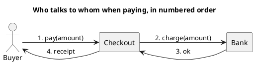

<p align="right">Idioma:&emsp;<a href="communication-v2.md" style="vertical-align:middle"></a> </p>

[🏠 UML Diagrams](../../../README.es.md) / [Generar un diagrama UML](../SKILL.es.md)

# Diagrama de comunicación UML 2

Fuente: OMG UML 2.5.1, anexo A. Este es el antiguo diagrama de colaboración de UML 1, con otro nombre y un marco de interacción.

## Pregunta que responde

Quién está enlazado con quién, y en qué orden viajan los mensajes.

## Diagrama fácil de leer

Guía para elegir qué dibujar cuando quien pide lo deja abierto. Nunca quita lo que pidió o aprobó (véase Fidelidad en el skill).

De tres a cinco líneas de vida en horizontal, enlaces y mensajes numerados. Prefiérelo al de secuencia cuando la pregunta es la red, no la columna del tiempo.

## Notación de esta versión

- Líneas de vida, conectores y mensajes con un número de secuencia.
- El orden sale del número, no de la altura.
- El nombre en v1 de este diagrama es colaboración. La semántica de los mensajes numerados se mantiene.
- Sin fragmentos combinados en el diagrama fácil de leer. Si hay ramas, el diagrama que las cuenta es el de secuencia de UML 2.

## Renderizado

PlantUML no tiene un diagrama de comunicación como tipo nativo. La entrega usa un grafo de izquierda a derecha con mensajes numerados y lo declara como aproximación.

## Plantilla

`../assets/communication-v2.puml`. Sustituye los nombres del dominio y conserva la forma.

## Ejemplo




## Ejemplos

Comando corto. El comando ya fija el diagrama, así que bastan unas palabras del dominio. El agente completa lo que dejas abierto.

```text
/uml-communication-v2 Paying an order.
```

Comando. Fija el diagrama. El resto es el dominio.

```text
/uml-communication-v2 Happy-path payment among buyer, checkout, and bank, with numbered messages.
```

Frase. La oración nombra el diagrama y el skill elige esta referencia.

```text
Draw a UML 2 communication diagram of the happy-path payment among buyer, checkout, and bank, with numbered messages.
```

## Terminado

- El dibujo responde quién está enlazado con quién, y en qué orden viajan los mensajes. El título enuncia esa pregunta. El orden sale del número de secuencia, no de la altura.
- Hay líneas de vida, conectores y mensajes numerados. No hay fragmentos combinados. Una rama pertenece a un diagrama de secuencia de UML 2, no a este.
- Cada elemento que se pidió o se aprobó está en la fuente. La guía añadió algo solo donde se dejó abierto, y la línea `Guide` lo dice.
- La línea `Render` dice aproximación: un grafo de izquierda a derecha con mensajes numerados, por la razón de esta referencia.
