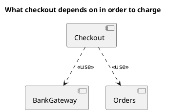

<p align="right">Idioma:&emsp;<a href="components-v1.md" style="vertical-align:middle"></a> </p>

[🏠 UML Diagrams](../../../README.es.md) / [Generar un diagrama UML](../SKILL.es.md)

# Diagrama de componentes UML 1

Fuente: OMG UML 1.5, diagrama de componentes.

## Pregunta que responde

Qué componentes existen y de cuáles dependen.

## Diagrama fácil de leer

Una guía para elegir qué dibujar cuando la persona lo deja abierto. Nunca quita lo que la persona pidió o aprobó (ver Fidelidad en el skill).

De tres a cinco componentes y dependencias discontinuas con un estereotipo legible. Interfaces solo si la pregunta es qué se cumple, no cómo se despliega.

## Notación de esta versión

- Componente, interfaz, dependencia y realización.
- Sin puertos y sin conectores de ensamble. Eso es UML 2.
- El nodo donde se instala pertenece al diagrama de despliegue.

## Renderizado

PlantUML dibuja componentes y dependencias de forma nativa. Un pedido v1 no usa portin, portout ni conectores de estructura compuesta.

## Plantilla

`../assets/components-v1.puml`. Sustituye los nombres del dominio y conserva la forma.

## Ejemplo




## Ejemplos

Comando corto. El comando ya fija el diagrama, así que bastan unas palabras del dominio. El agente completa lo que dejas abierto.

```text
/uml-components-v1 Checkout and the bank.
```

Comando. Fija el diagrama. El resto es el dominio.

```text
/uml-components-v1 Checkout depends on the bank gateway and on orders. No ports.
```

Frase. La oración nombra el diagrama, y el skill elige esta referencia.

```text
Draw a UML 1 component diagram: checkout depends on the bank gateway and on orders. No ports.
```

## Terminado

- El dibujo responde qué componentes existen y de cuáles dependen. El título enuncia esa pregunta.
- Hay componentes, interfaces, dependencias y realizaciones. No hay puertos ni conectores de ensamble. No está el nodo donde se instala.
- Cada elemento que la persona pidió o aprobó está en la fuente. La guía añadió algo solo donde la persona lo dejó abierto, y la línea Guide lo dice.
- El renderizado es PlantUML nativo. La entrega no lo llama aproximación y no usa `portin` ni `portout`.
