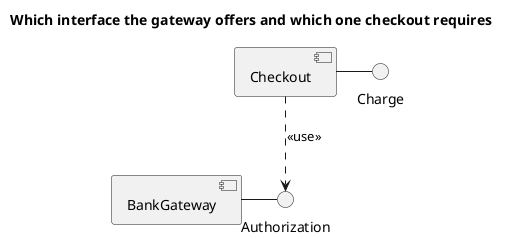

<p align="right">Idioma:&emsp;<a href="components-v2.md" style="vertical-align:middle"></a> </p>

[🏠 UML Diagrams](../../../README.es.md) / [Generar un diagrama UML](../SKILL.es.md)

# Diagrama de componentes UML 2

Fuente: OMG UML 2.5.1, anexo A, diagrama de componentes.

## Pregunta que responde

Qué componentes se ensamblan y qué interfaces ofrecen o requieren.

## Diagrama fácil de leer

Guía para elegir qué dibujar cuando quien pide lo deja abierto. Nunca quita lo que pidió o aprobó (véase Fidelidad en el skill).

De dos a cuatro componentes. Una interfaz proporcionada como piruleta y una interfaz requerida explícita. Un ensamble por pregunta, no un mapa de todo el sistema.

## Notación de esta versión

- Componente, interfaz proporcionada, interfaz requerida y dependencia de uso.
- Puerto y conector de ensamble cuando importa el límite del componente.
- Esas piezas no se copian en un diagrama de componentes de UML 1.

## Renderizado

PlantUML dibuja componentes e interfaces de forma nativa. La piruleta se aproxima con la interfaz unida por una línea continua al componente que la proporciona, y una dependencia discontinua desde el que la requiere.

## Plantilla

`../assets/components-v2.puml`. Sustituye los nombres del dominio y conserva la forma.

## Ejemplo




## Ejemplos

Comando corto. El comando ya fija el diagrama, así que bastan unas palabras del dominio. El agente completa lo que dejas abierto.

```text
/uml-components-v2 Checkout and the bank.
```

Comando. Fija el diagrama. El resto es el dominio.

```text
/uml-components-v2 Checkout provides Charge and uses Authorization, which the bank gateway provides.
```

Frase. La oración nombra el diagrama y el skill elige esta referencia.

```text
Draw a UML 2 component diagram: checkout provides Charge and uses Authorization, which the bank gateway provides.
```

## Terminado

- El dibujo responde qué componentes se ensamblan y qué interfaces ofrecen o requieren. El título enuncia esa pregunta.
- Hay componentes, interfaces proporcionadas, interfaces requeridas y dependencias de uso. Un puerto o un conector de ensamble aparece solo cuando importa el límite del componente.
- Cada elemento que se pidió o se aprobó está en la fuente. La guía añadió algo solo donde se dejó abierto, y la línea `Guide` lo dice.
- Si una interfaz proporcionada se dibuja como una línea continua hacia el componente, la línea `Render` dice que esa piruleta es una aproximación, por la razón de esta referencia.
