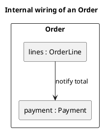
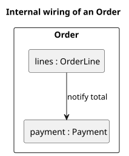

<p align="right">Idioma:&emsp;<a href="composite-v2.md" style="vertical-align:middle"></a> </p>

[🏠 UML Diagrams](../../../README.es.md) / [Generar un diagrama UML](../SKILL.es.md)

# Diagrama de estructura compuesta UML 2

Fuente: OMG UML 2.5.1, anexo A, diagrama de estructura compuesta. No existe en el catálogo v1.

## Pregunta que responde

Qué partes tiene un clasificador por dentro y cómo están conectadas.

## Diagrama fácil de leer

Guía para elegir qué dibujar cuando quien pide lo deja abierto. Nunca quita lo que pidió o aprobó (véase Fidelidad en el skill).

Un clasificador exterior y de dos a cuatro partes con un rol `: Type`. Conectores entre las partes. Puertos solo en el límite que muestra el exterior.

## Notación de esta versión

- Parte, puerto y conector.
- Una parte se nombra `role : Type`.
- Esto no es un diagrama de clases: no lista el catálogo de tipos. Muestra el cableado de un clasificador.

## Renderizado

PlantUML no tiene un diagrama de estructura compuesta como tipo nativo. La entrega usa un contenedor y rectángulos interiores como aproximación de las partes y los conectores, y lo declara.

## Plantilla

`../assets/composite-v2.puml`. Sustituye los nombres del dominio y conserva la forma.

## Ejemplo





## Ejemplos

Comando corto. El comando ya fija el diagrama, así que bastan unas palabras del dominio. El agente completa lo que dejas abierto.

```text
/uml-composite-v2 The inside of an order.
```

Comando. Fija el diagrama. El resto es el dominio.

```text
/uml-composite-v2 Order has the parts lines and payment, and the lines notify the total to the payment.
```

Frase. La oración nombra el diagrama y el skill elige esta referencia.

```text
Draw the UML 2 composite structure of Order: inside it has the parts lines and payment, and the lines notify the total to the payment.
```

## Terminado

- El dibujo responde qué partes tiene un clasificador por dentro y cómo están conectadas. El título enuncia esa pregunta.
- Las partes se nombran `role : Type`, con puertos y conectores. No es un catálogo de tipos y no lista cada atributo de un diagrama de clases.
- Cada elemento que se pidió o se aprobó está en la fuente. La guía añadió algo solo donde se dejó abierto, y la línea `Guide` lo dice.
- La línea `Render` dice aproximación: un contenedor y rectángulos interiores, por la razón de esta referencia.
