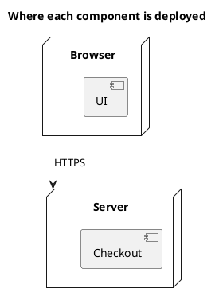

<p align="right">Idioma:&emsp;<a href="deployment-v1.md" style="vertical-align:middle"></a> </p>

[🏠 UML Diagrams](../../../README.es.md) / [Generar un diagrama UML](../SKILL.es.md)

# Diagrama de despliegue UML 1

Fuente: OMG UML 1.5, diagrama de despliegue.

## Pregunta que responde

En qué nodos se asienta cada componente.

## Diagrama fácil de leer

Una guía para elegir qué dibujar cuando la persona lo deja abierto. Nunca quita lo que la persona pidió o aprobó (ver Fidelidad en el skill).

Dos o tres nodos, los componentes dentro del nodo donde corren y una línea de comunicación entre nodos. Un entorno, el que nombra el título.

## Notación de esta versión

- Nodo, componente desplegado en el nodo y asociación de comunicación.
- El artefacto es UML 2. En v1 el componente va dentro del nodo.
- Un diagrama por entorno. Producción y prueba no comparten el mismo dibujo.

## Renderizado

PlantUML dibuja nodos y componentes de forma nativa.

## Plantilla

`../assets/deployment-v1.puml`. Sustituye los nombres del dominio y conserva la forma.

## Ejemplo




## Ejemplos

Comando corto. El comando ya fija el diagrama, así que bastan unas palabras del dominio. El agente completa lo que dejas abierto.

```text
/uml-deployment-v1 The store in production.
```

Comando. Fija el diagrama. El resto es el dominio.

```text
/uml-deployment-v1 The UI in the browser and checkout on the server, joined by HTTPS. No UML 2 artifacts.
```

Frase. La oración nombra el diagrama, y el skill elige esta referencia.

```text
Draw a UML 1 deployment diagram of production: the UI in the browser and checkout on the server, joined by HTTPS. No UML 2 artifacts.
```

## Terminado

- El dibujo responde en qué nodos se asienta cada componente. El título enuncia esa pregunta.
- El componente va dentro del nodo, con una asociación de comunicación. El artefacto de UML 2 no está. Un diagrama es un entorno: producción y prueba no están en el mismo dibujo.
- Cada elemento que la persona pidió o aprobó está en la fuente. La guía añadió algo solo donde la persona lo dejó abierto, y la línea Guide lo dice.
- El renderizado son nodos y componentes nativos. La entrega no lo llama aproximación.
