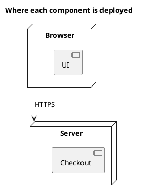

<p align="right">Language:&emsp; <a href="deployment-v1.es.md" style="vertical-align:middle"></a></p>

[🏠 UML Diagrams](../../../README.md) / [Generate a UML diagram](../SKILL.md)

# UML 1 deployment diagram

Source: OMG UML 1.5, deployment diagram.

## Question it answers

On which nodes each component sits.

## Diagram that is easy to read

A guide for choosing what to draw when the user leaves it open. It never removes what the user asked for or approved (see Fidelity in the skill).

Two or three nodes, the components inside the node where they run, and a communication line between nodes. One environment, the one named in the title.

## Notation for this version

- Node, component deployed on the node, and communication association.
- The artifact is UML 2. In v1 the component sits inside the node.
- One diagram per environment. Production and test do not share the same drawing.

## Render

PlantUML draws nodes and components natively.

## Template

`../assets/deployment-v1.puml`. Replace the domain names and keep the shape.

## Example




## Examples

Short command. The command already fixes the diagram, so a few words of domain are enough. The agent fills in what you leave open.

```text
/uml-deployment-v1 The store in production.
```

Command. It fixes the diagram. The rest is the domain.

```text
/uml-deployment-v1 The UI in the browser and checkout on the server, joined by HTTPS. No UML 2 artifacts.
```

Prompt. The sentence names the diagram, and the skill chooses this reference.

```text
Draw a UML 1 deployment diagram of production: the UI in the browser and checkout on the server, joined by HTTPS. No UML 2 artifacts.
```

## Done

- The drawing answers on which nodes each component sits. The title states that question.
- The component sits inside the node, with a communication association. The UML 2 artifact is absent. One diagram is one environment: production and test are not on the same drawing.
- Every element the user asked for or approved is in the source. The guide added something only where the user left it open, and the Guide line says so.
- Render is native nodes and components. The delivery does not call it an approximation.
