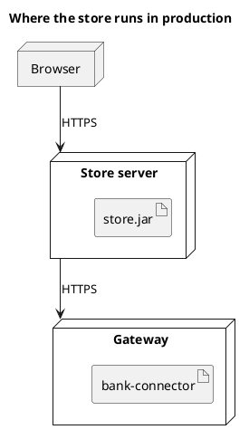

<p align="right">Idioma:&emsp;<a href="deployment-v2.md" style="vertical-align:middle"></a> </p>

[🏠 UML Diagrams](../../../README.es.md) / [Generar un diagrama UML](../SKILL.es.md)

# Diagrama de despliegue UML 2

Fuente: OMG UML 2.5.1, anexo A, diagrama de despliegue.

## Pregunta que responde

Qué artefactos corren en qué nodos.

## Diagrama fácil de leer

Guía para elegir qué dibujar cuando quien pide lo deja abierto. Nunca quita lo que pidió o aprobó (véase Fidelidad en el skill).

De dos a cuatro nodos, el artefacto dentro del nodo y la ruta de comunicación con su protocolo. Un entorno por diagrama.

## Notación de esta versión

- Nodo, dispositivo o entorno de ejecución, artefacto y ruta de comunicación.
- El artefacto es el elemento desplegable de UML 2. Un componente suelto dentro del nodo es la lectura de UML 1.
- Manifiestos y especificaciones de despliegue solo si el pedido los nombra.

## Renderizado

PlantUML dibuja este diagrama de forma nativa.

## Plantilla

`../assets/deployment-v2.puml`. Sustituye los nombres del dominio y conserva la forma.

## Ejemplo




## Ejemplos

Comando corto. El comando ya fija el diagrama, así que bastan unas palabras del dominio. El agente completa lo que dejas abierto.

```text
/uml-deployment-v2 The store in production.
```

Comando. Fija el diagrama. El resto es el dominio.

```text
/uml-deployment-v2 Store.jar on the store server, bank-connector on the gateway, and the browser talks to the server over HTTPS.
```

Frase. La oración nombra el diagrama y el skill elige esta referencia.

```text
Draw a UML 2 deployment diagram of production: store.jar on the store server, bank-connector on the gateway, and the browser talks to the server over HTTPS.
```

## Terminado

- El dibujo responde qué artefactos corren en qué nodos. El título enuncia esa pregunta.
- Hay nodos, artefactos y rutas de comunicación. No está el componente suelto dentro del nodo, que es la lectura de UML 1. Los manifiestos aparecen solo si el pedido los nombra.
- Cada elemento que se pidió o se aprobó está en la fuente. La guía añadió algo solo donde se dejó abierto, y la línea `Guide` lo dice.
- El render es PlantUML nativo. La entrega no lo llama aproximación.
