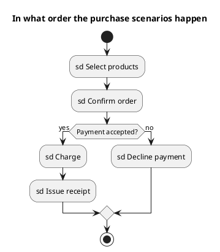

<p align="right">Idioma:&emsp;<a href="interaction-overview-v2.md" style="vertical-align:middle"></a> </p>

[🏠 UML Diagrams](../../../README.es.md) / [Generar un diagrama UML](../SKILL.es.md)

# Diagrama de vista general de interacción UML 2

Fuente: OMG UML 2.5.1, anexo A. La interacción es la familia: secuencia, comunicación, tiempos y esta vista general. No es un decimoquinto diagrama.

## Pregunta que responde

En qué orden se suceden varios escenarios ya definidos.

## Diagrama fácil de leer

Guía para elegir qué dibujar cuando quien pide lo deja abierto. Nunca quita lo que pidió o aprobó (véase Fidelidad en el skill).

La forma de una actividad: un inicio, nodos que nombran una interacción (`sd Name`), una decisión y un fin. Cada nodo es un escenario, no un paso de negocio suelto.

## Notación de esta versión

- Nodos de control como en una actividad, con usos de interacción (`ref`) en los nodos.
- El detalle de los mensajes vive en el diagrama de secuencia de ese `sd`.
- La secuencia completa no se expande dentro de cada nodo.

## Renderizado

PlantUML no tiene un marco de vista general de interacción. La entrega usa una actividad cuyas etiquetas empiezan por `sd` y lo declara. Esas etiquetas son escenarios, no acciones de un diagrama de actividades.

## Plantilla

`../assets/interaction-overview-v2.puml`. Sustituye los nombres del dominio y conserva la forma.

## Ejemplo




## Ejemplos

Comando corto. El comando ya fija el diagrama, así que bastan unas palabras del dominio. El agente completa lo que dejas abierto.

```text
/uml-interaction-overview-v2 A purchase.
```

Comando. Fija el diagrama. El resto es el dominio.

```text
/uml-interaction-overview-v2 Select products, confirm the order, and, if the payment is accepted, charge and issue a receipt; otherwise decline the payment. Each node is an sd scenario.
```

Frase. La oración nombra el diagrama y el skill elige esta referencia.

```text
Draw the UML 2 interaction overview of a purchase: select products, confirm the order, and, if the payment is accepted, charge and issue a receipt; otherwise decline the payment. Each node is an sd scenario.
```

## Terminado

- El dibujo responde en qué orden se suceden varios escenarios ya definidos. El título enuncia esa pregunta.
- Los nodos son usos de interacción cuyas etiquetas empiezan por `sd`. El detalle de los mensajes de cada escenario no se expande dentro del nodo.
- Cada escenario que se pidió o se aprobó está en la fuente. La guía añadió algo solo donde se dejó abierto, y la línea `Guide` lo dice.
- La línea `Render` dice aproximación: una actividad cuyas etiquetas empiezan por `sd`, y esas etiquetas son escenarios, no acciones.
