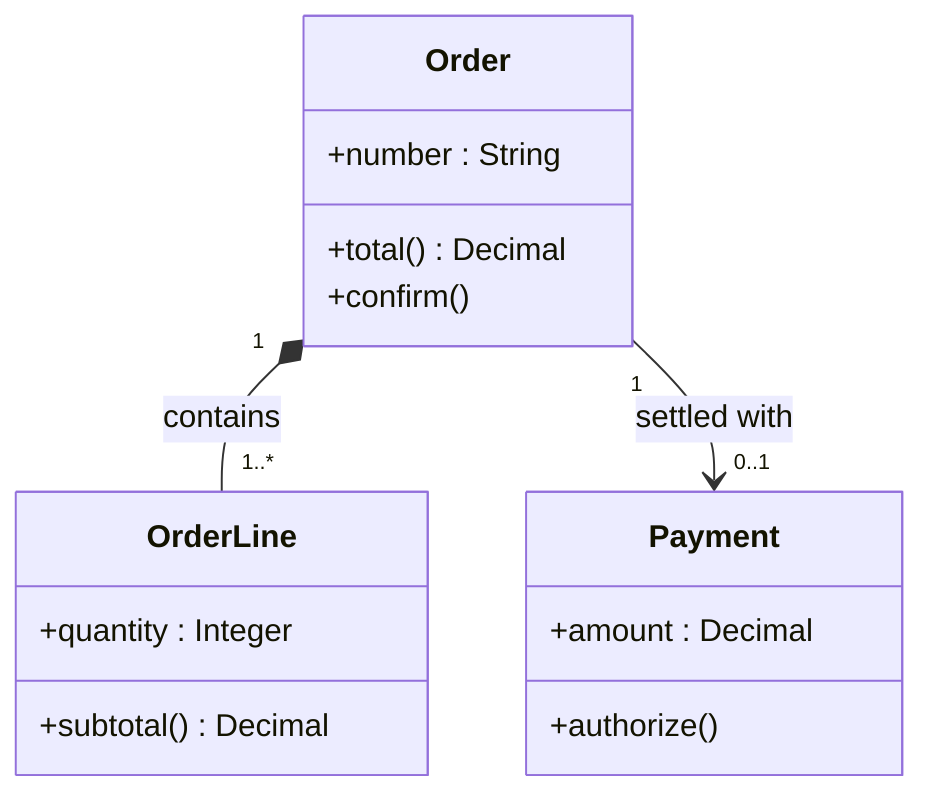
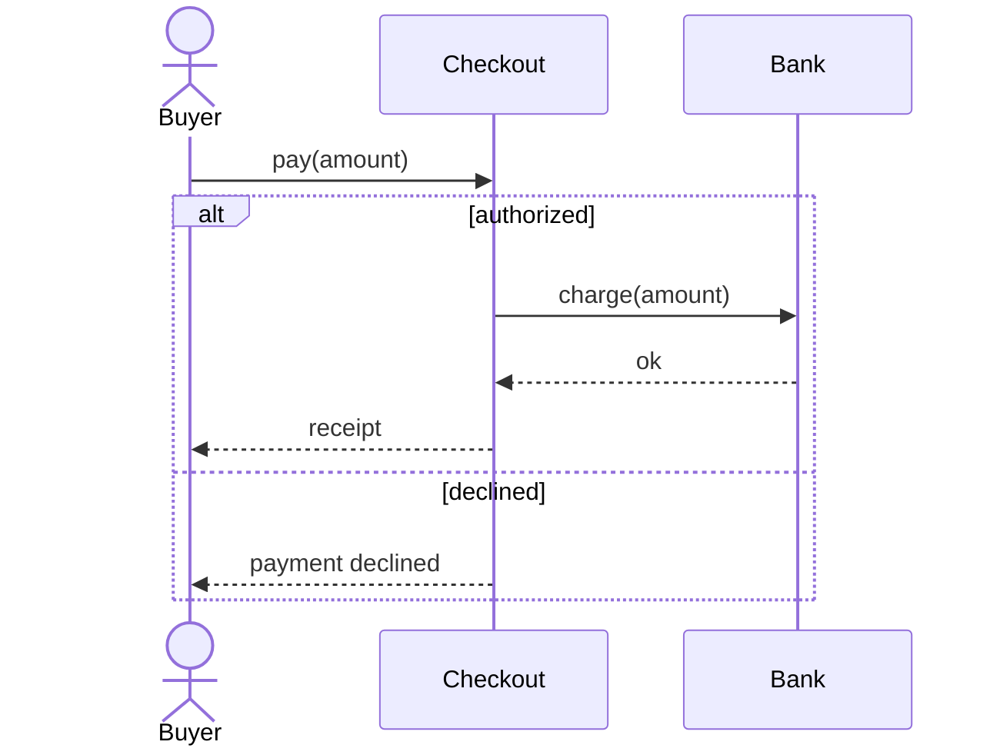
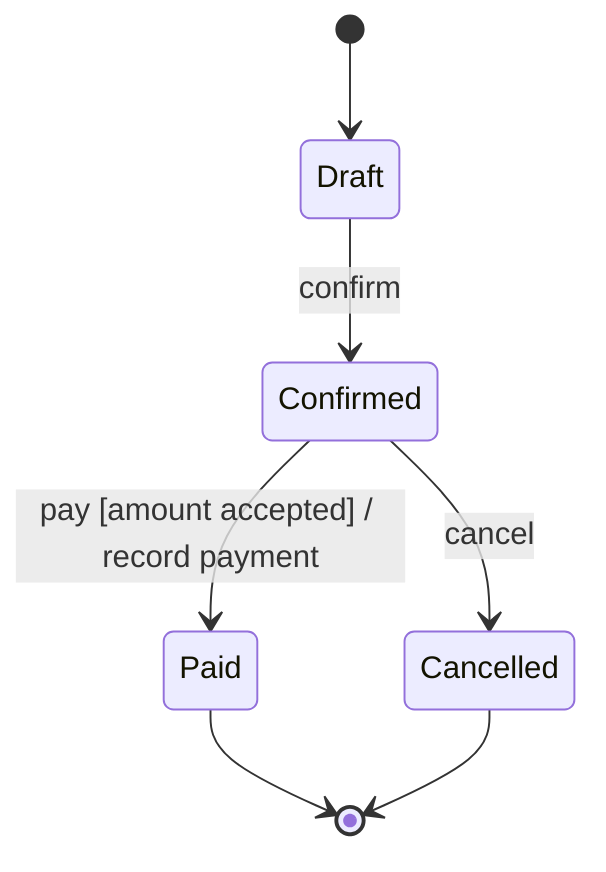

<p align="right">Idioma:&emsp;<a href="mermaid.md" style="vertical-align:middle"></a> </p>

[🏠 UML Diagrams](../../../README.es.md) / [Generar un diagrama UML](../SKILL.es.md)

# Mermaid, formato secundario

Fuente: sintaxis de Mermaid 12 para diagramas de [clases](https://mermaid.js.org/syntax/classDiagram.html), de [secuencia](https://mermaid.js.org/syntax/sequenceDiagram.html) y de [estados](https://mermaid.js.org/syntax/stateDiagram.html). La notación UML sigue saliendo de la referencia del tipo y de la versión.

## Cuándo escribirlo

Mermaid dibuja de forma nativa solo estos tipos del catálogo:

| Id | Tipo de Mermaid |
| --- | --- |
| `classes-v1`, `classes-v2` | `classDiagram` |
| `sequence-v1`, `sequence-v2` | `sequenceDiagram` |
| `states-v1`, `state-machine-v2` | `stateDiagram-v2` |

Cualquier otro id no recibe archivo Mermaid. No aproximes un diagrama UML con `flowchart`.

También se omite cuando el dibujo usa un elemento que Mermaid no tiene, y ese elemento se nombra en la entrega:

- Secuencia: uso de interacción (`ref`) y puertas.
- Estado: historial `[H]`, puntos de entrada y de salida, y transiciones entre subestados de estados compuestos distintos.

## Archivo

`<folder>/<id>-<topic>.md`, junto al `.puml` del mismo nombre. Lleva el título como encabezado y un bloque `mermaid`. GitHub, GitLab y Azure DevOps lo renderizan sin instalar nada.

El bloque Mermaid dibuja los mismos elementos, nombres y relaciones que el `.puml`. Siguen vigentes las reglas de versión de la referencia:

- `sequence-v1` no usa `alt`, `opt`, `loop`, `par`, `critical` ni `break`.
- `states-v1` no usa regiones concurrentes (`--`).

## Notación

- Los miembros de clase se escriben `+name : Type` y `+operation() Type`. Mermaid dibuja el tipo de retorno como `: Type`.
- La multiplicidad va entre comillas en cada extremo: `Order "1" *-- "1..*" OrderLine : contains`.
- Mensaje síncrono `->>`, retorno `-->>`, mensaje asíncrono `-)`.
- Las transiciones de estado conservan la etiqueta `event [guard] / effect`.

## Ejemplos

Diagrama de clases, el mismo contenido que `classes-v2.puml`:

````markdown
# What data an order has and how it relates to its payment


````

Diagrama de secuencia, el mismo contenido que `sequence-v2.puml`:

````markdown
# What happens when paying if the bank authorizes or declines


````

Máquina de estados, el mismo contenido que `state-machine-v2.puml`:

````markdown
# Life of an order


````

## Terminado

Este archivo no es una situación. Evalúalo solo cuando el id del diagrama es `classes-v1`, `classes-v2`, `sequence-v1`, `sequence-v2`, `states-v1` o `state-machine-v2`. Cualquier otro id no tiene archivo Mermaid, y un diagrama UML no se dibuja como `flowchart`.

- El bloque usa el tipo de Mermaid de la tabla de arriba y los mismos elementos, nombres y relaciones que el `.puml`.
- Un constructo que esta referencia dice que Mermaid no puede dibujar se omite aquí, se nombra en la entrega y se conserva en el archivo PlantUML.
- `sequence-v1` no tiene fragmento combinado. `states-v1` no tiene región concurrente.
