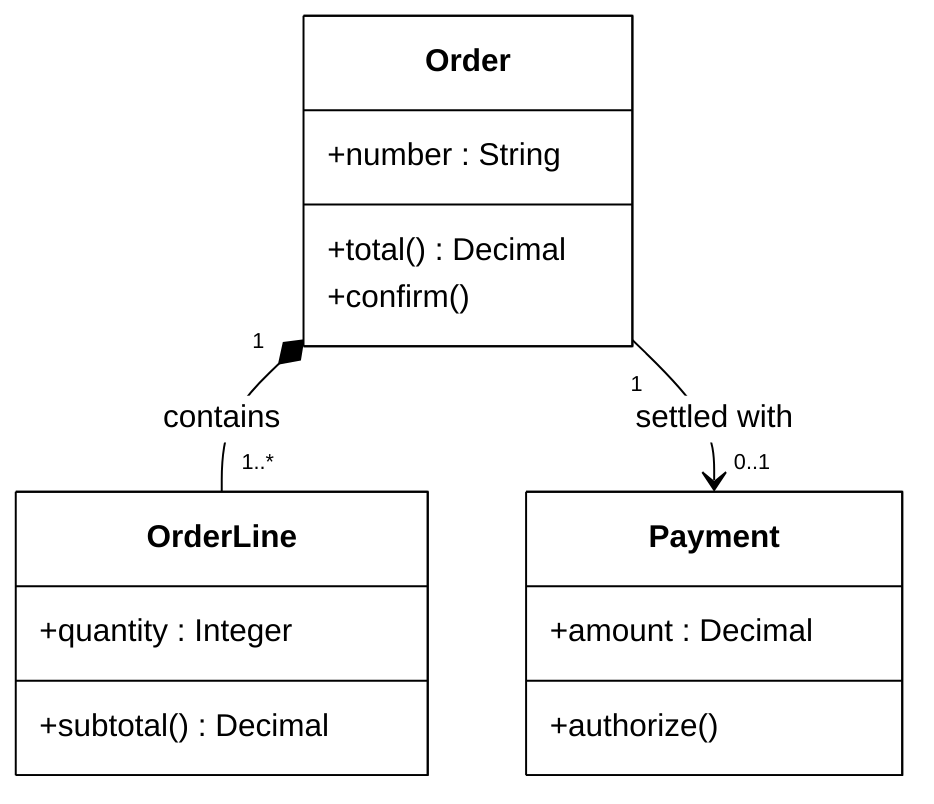
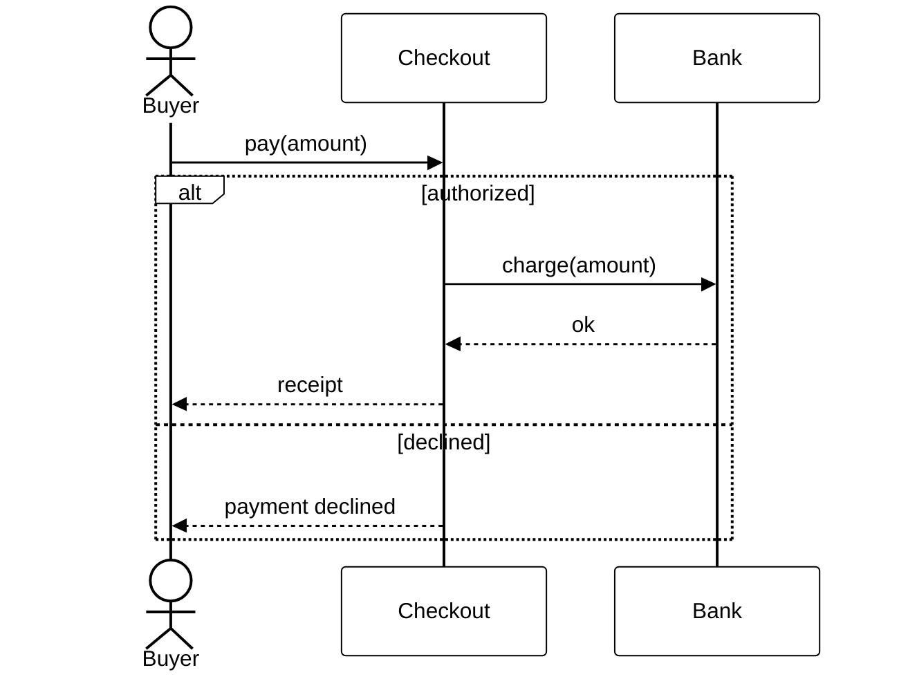
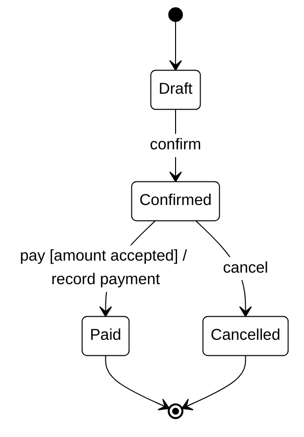

<p align="right">Language:&emsp; <a href="mermaid.es.md" style="vertical-align:middle"></a></p>

[🏠 UML Diagrams](../../../README.md) / [Generate a UML diagram](../SKILL.md)

# Mermaid, secondary format

Source: Mermaid 12 syntax for [class](https://mermaid.js.org/syntax/classDiagram.html), [sequence](https://mermaid.js.org/syntax/sequenceDiagram.html), and [state](https://mermaid.js.org/syntax/stateDiagram.html) diagrams. The UML notation still comes from the reference of the type and version.

## When to write it

Mermaid draws only these catalog types natively:

| Id | Mermaid type |
| --- | --- |
| `classes-v1`, `classes-v2` | `classDiagram` |
| `sequence-v1`, `sequence-v2` | `sequenceDiagram` |
| `states-v1`, `state-machine-v2` | `stateDiagram-v2` |

Any other id gets no Mermaid file. Do not approximate a UML diagram with `flowchart`.

Skip it too when the drawing uses an element Mermaid does not have, and name that element in the delivery:

- Sequence: interaction use (`ref`) and gates.
- State: history `[H]`, entry and exit points, and transitions between substates of different composite states.

## File

`<folder>/<NNN>-<id>-<topic>.md`, next to the `.puml` with the same `<NNN>`, `<id>`, and `<topic>`. It holds the title as a heading, one `mermaid` block, and then a reading. GitHub, GitLab, and Azure DevOps render the diagram without installing anything.

The reading is a heading in the language of the request. In English the heading is `## Reading`. Under it, one or two paragraphs say what the drawing answers and the path a reader follows. They use only names that appear in the diagram. They do not add a participant, a state, a message, or a relation.

The Mermaid block draws the same elements, names, and relations as the `.puml`. The version rules of the reference still apply:

- `sequence-v1` uses no `alt`, `opt`, `loop`, `par`, `critical`, or `break`.
- `states-v1` uses no concurrent regions (`--`).

## Presentation

The block starts with the init line in [style.md](style.md), so this view stays black on white with the PlantUML file.

## Notation

- Class members are written `+name : Type` and `+operation() Type`. Mermaid draws the return type as `: Type`.
- Multiplicity goes in quotes on each end: `Order "1" *-- "1..*" OrderLine : contains`.
- Synchronous message `->>`, return `-->>`, asynchronous message `-)`.
- State transitions keep the label `event [guard] / effect`.

## Examples

Class diagram, same content as `classes-v2.puml`:

````markdown
# What data an order has and how it relates to its payment



## Reading

An order contains its lines, and each line is part of that order. The order may be settled with one payment.
````

Sequence diagram, same content as `sequence-v2.puml`:

````markdown
# What happens when paying if the bank authorizes or declines



## Reading

The buyer asks checkout to pay. If the bank authorizes the charge, checkout returns a receipt. If the bank declines, checkout tells the buyer the payment was declined.
````

State machine, same content as `state-machine-v2.puml`:

````markdown
# Life of an order



## Reading

An order starts as a draft. Confirming it moves the order to confirmed. From there, an accepted payment records the order as paid, and cancelling ends it. A paid order is finished.
````

## Done

This file is not a situation. Evaluate it only when the diagram id is `classes-v1`, `classes-v2`, `sequence-v1`, `sequence-v2`, `states-v1`, or `state-machine-v2`. Any other id has no Mermaid file, and a UML diagram is not drawn as a `flowchart`.

- The block uses the Mermaid type in the table above and the same elements, names, and relations as the `.puml`.
- A construct this reference says Mermaid cannot draw is omitted here, named in the delivery, and kept in the PlantUML file.
- `sequence-v1` has no combined fragment. `states-v1` has no concurrent region.
- The block starts with the init line in `style.md`.
- After the block, a reading in the language of the request uses only names from the diagram.
