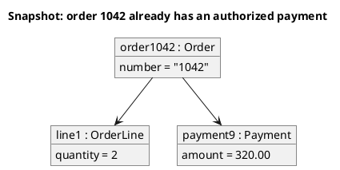
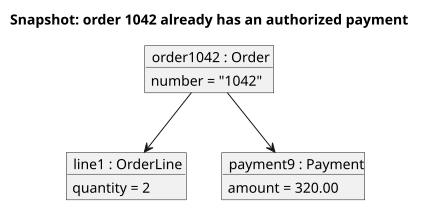

<p align="right">Idioma:&emsp;<a href="objects-v1.md" style="vertical-align:middle"></a> </p>

[🏠 UML Diagrams](../../../README.es.md) / [Generar un diagrama UML](../SKILL.es.md)

# Diagrama de objetos UML 1

Fuente: OMG UML 1.4 y 1.5. La notación define el diagrama de objetos; el punto de conformidad de UML 1.4 no lo separa del diagrama de clases.

## Pregunta que responde

Qué valores concretos tienen los objetos en un instante.

## Diagrama fácil de leer

Una guía para elegir qué dibujar cuando la persona lo deja abierto. Nunca quita lo que la persona pidió o aprobó (ver Fidelidad en el skill).

Unas pocas instancias, nombre subrayado `name : Type`, ranuras con valores y enlaces. Un momento, el que nombra el título.

## Notación de esta versión

- Una instancia con el nombre subrayado y el tipo.
- Ranuras `attribute = value`.
- Un enlace entre instancias, sin multiplicidad de clase.
- Esto no es un diagrama de clases con ejemplos escritos dentro de las cajas.

## Renderizado

PlantUML dibuja este diagrama de forma nativa con `object`.

## Plantilla

`../assets/objects-v1.puml`. Sustituye los nombres del dominio y conserva la forma.

## Ejemplo





## Ejemplos

Comando corto. El comando ya fija el diagrama, así que bastan unas palabras del dominio. El agente completa lo que dejas abierto.

```text
/uml-objects-v1 One paid order.
```

Comando. Fija el diagrama. El resto es el dominio.

```text
/uml-objects-v1 Order 1042 is paid, it has one line with quantity 2, and a payment of 320.00.
```

Frase. La oración nombra el diagrama, y el skill elige esta referencia.

```text
Draw a UML 1 object diagram of one instant: order 1042 is paid, it has one line with quantity 2, and a payment of 320.00.
```

## Terminado

- El dibujo responde qué valores concretos tienen los objetos en un instante. El título enuncia esa pregunta.
- Cada instancia tiene nombre y tipo subrayados, ranuras `attribute = value` y enlaces. No hay multiplicidad de clase. No es un diagrama de clases con ejemplos dentro de las cajas.
- Cada elemento que la persona pidió o aprobó está en la fuente. La guía añadió algo solo donde la persona lo dejó abierto, y la línea Guide lo dice.
- El renderizado es `object` nativo de PlantUML. La entrega no lo llama aproximación.
