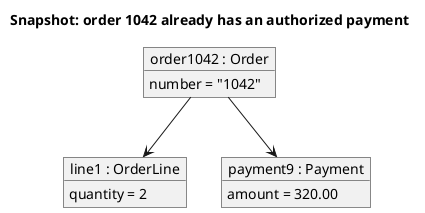

<p align="right">Idioma:&emsp;<a href="objects-v2.md" style="vertical-align:middle"></a> </p>

[🏠 UML Diagrams](../../../README.es.md) / [Generar un diagrama UML](../SKILL.es.md)

# Diagrama de objetos UML 2

Fuente: OMG UML 2.5.1, anexo A, diagrama de objetos.

## Pregunta que responde

Qué valores concretos tienen las instancias en un instante.

## Diagrama fácil de leer

Guía para elegir qué dibujar cuando quien pide lo deja abierto. Nunca quita lo que pidió o aprobó (véase Fidelidad en el skill).

Unas pocas instancias subrayadas, ranuras y enlaces. Un momento.

## Notación de esta versión

- Especificación de instancia: nombre y clasificador subrayados.
- Ranuras con valores.
- Enlaces, que son instancias de asociaciones.
- Si hace falta el tipo y no el valor, el diagrama que hay que dibujar es el de clases.

## Renderizado

PlantUML dibuja este diagrama de forma nativa con `object`.

## Plantilla

`../assets/objects-v2.puml`. Sustituye los nombres del dominio y conserva la forma.

## Ejemplo




## Ejemplos

Comando corto. El comando ya fija el diagrama, así que bastan unas palabras del dominio. El agente completa lo que dejas abierto.

```text
/uml-objects-v2 One paid order.
```

Comando. Fija el diagrama. El resto es el dominio.

```text
/uml-objects-v2 The instant when order 1042 is linked to its line and to a payment of 320.00.
```

Frase. La oración nombra el diagrama y el skill elige esta referencia.

```text
Draw a UML 2 object diagram of the instant when order 1042 is linked to its line and to a payment of 320.00.
```

## Terminado

- El dibujo responde qué valores concretos tienen las instancias en un instante. El título enuncia esa pregunta.
- Cada instancia está subrayada, con su clasificador, ranuras que guardan valores y enlaces. No es un diagrama de clases.
- Cada elemento que se pidió o se aprobó está en la fuente. La guía añadió algo solo donde se dejó abierto, y la línea `Guide` lo dice.
- El render es PlantUML nativo con `object`. La entrega no lo llama aproximación.
