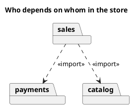
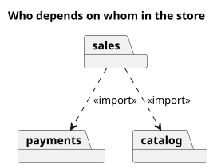

<p align="right">Idioma:&emsp;<a href="packages-v2.md" style="vertical-align:middle"></a> </p>

[🏠 UML Diagrams](../../../README.es.md) / [Generar un diagrama UML](../SKILL.es.md)

# Diagrama de paquetes UML 2

Fuente: OMG UML 2.5.1, anexo A, diagrama de paquetes. No existe en el catálogo v1.

## Pregunta que responde

Cómo se agrupa el modelo y qué paquete depende de cuál.

## Diagrama fácil de leer

Guía para elegir qué dibujar cuando quien pide lo deja abierto. Nunca quita lo que pidió o aprobó (véase Fidelidad en el skill).

Carpetas y dependencias discontinuas hacia el paquete más estable. Sin ciclos. «import» o «merge» solo cuando esa es la pregunta.

## Notación de esta versión

- Paquete y dependencia.
- «import» incorpora los nombres visibles. «merge» combina paquetes del mismo nivel conceptual.
- El contenido interno que no cambia la dependencia se deja fuera.

## Renderizado

PlantUML dibuja los paquetes dentro de un diagrama de clases, que es la forma nativa de este diagrama.

## Plantilla

`../assets/packages-v2.puml`. Sustituye los nombres del dominio y conserva la forma.

## Ejemplo





## Ejemplos

Comando corto. El comando ya fija el diagrama, así que bastan unas palabras del dominio. El agente completa lo que dejas abierto.

```text
/uml-packages-v2 Sales, payments, and catalog.
```

Comando. Fija el diagrama. El resto es el dominio.

```text
/uml-packages-v2 Sales imports payments and catalog, and there are no cycles.
```

Frase. La oración nombra el diagrama y el skill elige esta referencia.

```text
Draw a UML 2 package diagram: sales imports payments and catalog, and there are no cycles.
```

## Terminado

- El dibujo responde cómo se agrupa el modelo y qué paquete depende de cuál. El título enuncia esa pregunta.
- Hay paquetes y dependencias. «import» y «merge» se usan solo como los define esta referencia. El contenido interno que no cambia la dependencia no está.
- Cada elemento que se pidió o se aprobó está en la fuente. La guía añadió algo solo donde se dejó abierto, y la línea `Guide` lo dice.
- El render es paquetes nativos de PlantUML. La entrega no lo llama aproximación.
