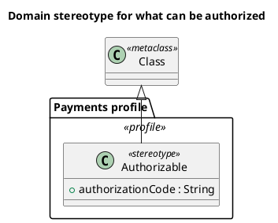
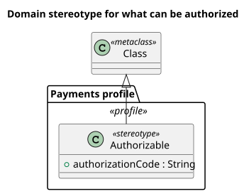

<p align="right">Idioma:&emsp;<a href="profiles-v2.md" style="vertical-align:middle"></a> </p>

[🏠 UML Diagrams](../../../README.es.md) / [Generar un diagrama UML](../SKILL.es.md)

# Diagrama de perfiles UML 2

Fuente: OMG UML 2.5.1, anexo A, diagrama de perfiles. Entra en UML 2 a partir de la 2.2. No existe en el catálogo v1.

## Pregunta que responde

Qué estereotipo extiende qué metaclase, y con qué etiquetas.

## Diagrama fácil de leer

Guía para elegir qué dibujar cuando quien pide lo deja abierto. Nunca quita lo que pidió o aprobó (véase Fidelidad en el skill).

Un paquete «profile», un estereotipo y una metaclase. La flecha de extensión apunta a la metaclase. Una o dos etiquetas, las que el dominio va a leer.

## Notación de esta versión

- Perfil, estereotipo, metaclase y extensión.
- Un valor etiquetado es un atributo del estereotipo.
- Esto no es un diagrama de clases de negocio: las cajas son conceptos del propio UML.

## Renderizado

PlantUML no tiene un diagrama de perfiles como tipo nativo. La entrega usa un paquete estereotipado, una clase «stereotype» y una generalización hacia la metaclase, y lo declara como aproximación de la extensión.

## Plantilla

`../assets/profiles-v2.puml`. Sustituye los nombres del dominio y conserva la forma.

## Ejemplo





## Ejemplos

Comando corto. El comando ya fija el diagrama, así que bastan unas palabras del dominio. El agente completa lo que dejas abierto.

```text
/uml-profiles-v2 A payments profile.
```

Comando. Fija el diagrama. El resto es el dominio.

```text
/uml-profiles-v2 The Payments profile defines the Authorizable stereotype, with the authorizationCode tag, extending the Class metaclass.
```

Frase. La oración nombra el diagrama y el skill elige esta referencia.

```text
Draw a UML 2 profile diagram: the Payments profile defines the Authorizable stereotype, with the authorizationCode tag, extending the Class metaclass.
```

## Terminado

- El dibujo responde qué estereotipo extiende qué metaclase, y con qué etiquetas. El título enuncia esa pregunta.
- Hay perfil, estereotipo, metaclase y extensión. Un valor etiquetado es un atributo del estereotipo. Las cajas son conceptos de UML, no clases de negocio.
- Cada elemento que se pidió o se aprobó está en la fuente. La guía añadió algo solo donde se dejó abierto, y la línea `Guide` lo dice.
- La línea `Render` dice aproximación: un paquete estereotipado, una clase «stereotype» y una generalización hacia la metaclase.
