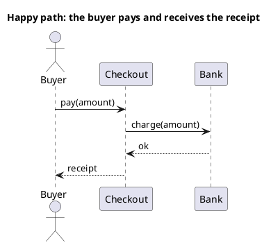
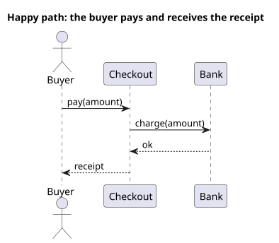

<p align="right">Idioma:&emsp;<a href="sequence-v1.md" style="vertical-align:middle"></a> </p>

[🏠 UML Diagrams](../../../README.es.md) / [Generar un diagrama UML](../SKILL.es.md)

# Diagrama de secuencia UML 1

Fuente: OMG UML 1.5, diagrama de secuencia.

## Pregunta que responde

Qué mensajes se intercambian en un solo escenario, de arriba abajo.

## Diagrama fácil de leer

Una guía para elegir qué dibujar cuando la persona lo deja abierto. Nunca quita lo que la persona pidió o aprobó (ver Fidelidad en el skill).

Un actor a la izquierda y dos o tres participantes. Un escenario, el camino feliz o una alternativa en un dibujo aparte. Mensajes síncronos con un retorno discontinuo.

## Notación de esta versión

- Líneas de vida y mensajes en orden temporal, de arriba abajo.
- Mensaje síncrono y retorno.
- Sin fragmentos combinados. alt, opt, loop, par, break y ref son UML 2.
- Un rechazo u otra rama es otro diagrama de secuencia, con su propio título.

## Renderizado

PlantUML dibuja la secuencia de forma nativa. Aunque acepte alt, un pedido v1 no lo usa.

## Plantilla

`../assets/sequence-v1.puml`. Sustituye los nombres del dominio y conserva la forma.

## Ejemplo





## Ejemplos

Comando corto. El comando ya fija el diagrama, así que bastan unas palabras del dominio. El agente completa lo que dejas abierto.

```text
/uml-sequence-v1 Paying an order.
```

Comando. Fija el diagrama. El resto es el dominio.

```text
/uml-sequence-v1 The buyer asks checkout to charge, checkout asks the bank, and if the bank answers ok, checkout returns the receipt. No alt fragments.
```

Frase. La oración nombra el diagrama, y el skill elige esta referencia.

```text
Draw the UML 1 sequence diagram of the happy path for paying: the buyer asks checkout to charge, checkout asks the bank, and if the bank answers ok, checkout returns the receipt. No alt fragments.
```

## Terminado

- El dibujo responde qué mensajes se intercambian en un solo escenario, de arriba abajo. El título enuncia esa pregunta.
- No hay fragmento combinado: ni `alt`, ni `opt`, ni `loop`, ni `par`, ni `break`, ni `ref`, aunque PlantUML los aceptara. Una rama es otro diagrama, con su propio título, y la línea Fidelity lo dice.
- Cada mensaje que la persona pidió o aprobó está en la fuente. No se quitó nada.
- El renderizado es secuencia nativa. La entrega no lo llama aproximación.
