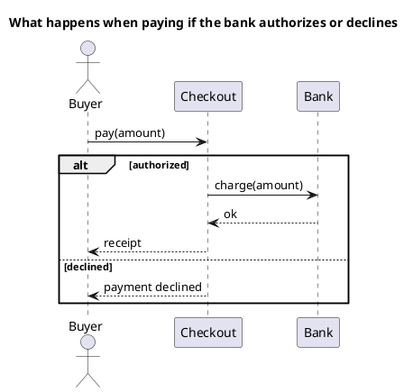
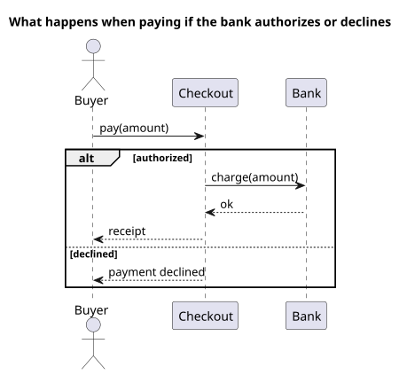

<p align="right">Idioma:&emsp;<a href="sequence-v2.md" style="vertical-align:middle"></a> </p>

[🏠 UML Diagrams](../../../README.es.md) / [Generar un diagrama UML](../SKILL.es.md)

# Diagrama de secuencia UML 2

Fuente: OMG UML 2.5.1, anexo A, diagrama de secuencia. Los fragmentos combinados se especifican en Interacciones.

## Pregunta que responde

Qué mensajes se intercambian a lo largo del tiempo, incluidas las ramas que de verdad importan.

## Diagrama fácil de leer

Guía para elegir qué dibujar cuando quien pide lo deja abierto. Nunca quita lo que pidió o aprobó (véase Fidelidad en el skill).

Un actor a la izquierda, dos o tres líneas de vida, leídas de arriba abajo. Como mucho un fragmento alt, opt o loop. El título nombra el escenario.

## Notación de esta versión

- Líneas de vida, mensajes síncronos y retornos.
- Fragmentos combinados: alt, opt y loop cubren casi todo pedido. par solo cuando hay paralelismo real.
- Cada operando de alt tiene una guarda.
- Un diagrama de secuencia v1 del mismo nombre no usa estos fragmentos.

## Renderizado

PlantUML dibuja este diagrama de forma nativa, incluidos alt, opt y loop.

## Plantilla

`../assets/sequence-v2.puml`. Sustituye los nombres del dominio y conserva la forma.

## Ejemplo





## Ejemplos

Comando corto. El comando ya fija el diagrama, así que bastan unas palabras del dominio. El agente completa lo que dejas abierto.

```text
/uml-sequence-v2 Paying an order.
```

Comando. Fija el diagrama. El resto es el dominio.

```text
/uml-sequence-v2 Paying an order, with one alt: if the bank authorizes, checkout returns the receipt; if it declines, checkout tells the buyer.
```

Frase. La oración nombra el diagrama y el skill elige esta referencia.

```text
Draw a UML 2 sequence diagram of paying an order, with one alt: if the bank authorizes, checkout returns the receipt; if it declines, checkout tells the buyer.
```

## Terminado

- El dibujo responde qué mensajes se intercambian a lo largo del tiempo, incluidas las ramas que importan. El título enuncia esa pregunta.
- Hay líneas de vida, mensajes y retornos según los necesita el escenario. Cada operando de `alt` tiene una guarda. Los fragmentos combinados son solo `alt`, `opt`, `loop` o `par` cuando hay paralelismo real.
- Cada mensaje que se pidió o se aprobó está en la fuente. No se quitó nada. La guía añadió algo solo donde se dejó abierto, y la línea `Guide` lo dice.
- El render es PlantUML nativo, incluidos `alt`, `opt` y `loop`. La entrega no lo llama aproximación.
