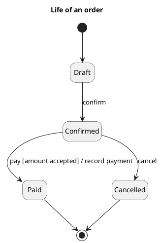

<p align="right">Idioma:&emsp;<a href="state-machine-v2.md" style="vertical-align:middle"></a> </p>

[🏠 UML Diagrams](../../../README.es.md) / [Generar un diagrama UML](../SKILL.es.md)

# Diagrama de máquina de estados UML 2

Fuente: OMG UML 2.5.1, anexo A, diagrama de máquina de estados. En UML 1 el nombre es statechart.

## Pregunta que responde

Qué vida recorre un objeto, y qué evento, guarda y efecto cambian su estado.

## Diagrama fácil de leer

Guía para elegir qué dibujar cuando quien pide lo deja abierto. Nunca quita lo que pidió o aprobó (véase Fidelidad en el skill).

Un clasificador, de tres a seis estados, una transición `event [guard] / effect`. Regiones solo si dos partes del mismo objeto evolucionan a la vez. Historia `[H]` solo si el pedido necesita recordar el subestado.

## Notación de esta versión

- Estado, pseudoestado inicial, estado final y transición.
- Comportamientos entry, do y exit cuando el estado hace algo mientras dura.
- Región ortogonal y estado de historia cuando la vida no es una sola línea.
- Un pedido que dice statechart o states, sin la versión 2, usa la referencia states-v1.

## Renderizado

PlantUML dibuja la máquina de estados de forma nativa.

## Plantilla

`../assets/state-machine-v2.puml`. Sustituye los nombres del dominio y conserva la forma.

## Ejemplo




## Ejemplos

Comando corto. El comando ya fija el diagrama, así que bastan unas palabras del dominio. El agente completa lo que dejas abierto.

```text
/uml-state-machine-v2 The life of an order.
```

Comando. Fija el diagrama. El resto es el dominio.

```text
/uml-state-machine-v2 An order, from draft to confirmed, and from there to paid or cancelled. The move to paid requires the amount to be accepted and records the payment.
```

Frase. La oración nombra el diagrama y el skill elige esta referencia.

```text
Draw the UML 2 state machine of an order, from draft to confirmed, and from there to paid or cancelled. The move to paid requires the amount to be accepted and records the payment.
```

## Terminado

- El dibujo responde qué vida recorre un objeto, y qué evento, guarda y efecto cambian su estado. El título enuncia esa pregunta.
- Hay estados, un pseudoestado inicial, un estado final y transiciones. Entry, do y exit aparecen cuando el estado hace algo mientras dura. Una región ortogonal o un estado de historia aparece solo cuando la vida no es una sola línea.
- Un pedido que dice statechart o states, sin la versión 2, no es este archivo.
- Cada elemento que se pidió o se aprobó está en la fuente. La guía añadió algo solo donde se dejó abierto, y la línea `Guide` lo dice.
- El render es una máquina de estados nativa. La entrega no lo llama aproximación.
