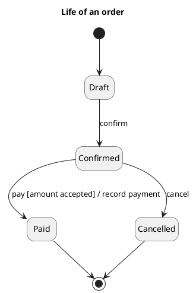

[🏠 UML Diagrams](../../../README.md) / [Generate a UML diagram](../SKILL.md)

# UML 2 state machine diagram

Source: OMG UML 2.5.1, Annex A, state machine diagram. In UML 1 the name is statechart.

## Question it answers

What life an object goes through, and which event, guard, and effect change its state.

## Diagram that is easy to read

A guide for choosing what to draw when the user leaves it open. It never removes what the user asked for or approved (see Fidelity in the skill).

One classifier, three to six states, a transition `event [guard] / effect`. Regions only if two parts of the same object evolve at once. History `[H]` only if the request needs to remember the substate.

## Notation for this version

- State, initial pseudostate, final state, and transition.
- entry, do, and exit behaviors when the state does something while it lasts.
- Orthogonal region and history state when the life is not a single line.
- A request that says statechart or states, without version 2, uses the states-v1 reference.

## Render

PlantUML draws the state machine natively.

## Template

`../assets/state-machine-v2.puml`. Replace the domain names and keep the shape.

## Example




## Examples

Short command. The command already fixes the diagram, so a few words of domain are enough. The agent fills in what you leave open.

```text
/uml-state-machine-v2 The life of an order.
```

Command. It fixes the diagram. The rest is the domain.

```text
/uml-state-machine-v2 An order, from draft to confirmed, and from there to paid or cancelled. The move to paid requires the amount to be accepted and records the payment.
```

Prompt. The sentence names the diagram, and the skill chooses this reference.

```text
Draw the UML 2 state machine of an order, from draft to confirmed, and from there to paid or cancelled. The move to paid requires the amount to be accepted and records the payment.
```

## Done

- The drawing answers what life an object goes through, and which event, guard, and effect change its state. The title states that question.
- States, an initial pseudostate, a final state, and transitions are present. Entry, do, and exit appear when the state does something while it lasts. An orthogonal region or a history state appears only when the life is not a single line.
- A request that says statechart or states, without version 2, is not this file.
- Every element the user asked for or approved is in the source. The guide added something only where the user left it open, and the Guide line says so.
- Render is a native state machine. The delivery does not call it an approximation.
