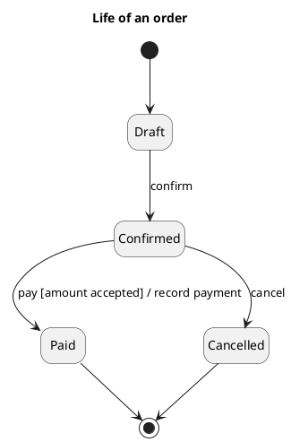

<p align="right">Idioma:&emsp;<a href="states-v1.md" style="vertical-align:middle"></a> </p>

[🏠 UML Diagrams](../../../README.es.md) / [Generar un diagrama UML](../SKILL.es.md)

# Diagrama statechart UML 1

Fuente: OMG UML 1.5, statechart. En UML 2 el diagrama se llama máquina de estados.

## Pregunta que responde

Qué vida recorre un solo objeto, y qué evento lo hace cambiar.

## Diagrama fácil de leer

Una guía para elegir qué dibujar cuando la persona lo deja abierto. Nunca quita lo que la persona pidió o aprobó (ver Fidelidad en el skill).

Un objeto, de tres a seis estados, un estado inicial y un estado final. Cada transición se lee `event [guard] / action`. Sin regiones ortogonales: si dos partes cambian a la vez, son dos máquinas.

## Notación de esta versión

- Estado, estado inicial, estado final y transición.
- Etiqueta `event [guard] / action`.
- Un estado compuesto simple cabe si agrupa una vida interior.
- Las regiones ortogonales y la máquina de protocolo son UML 2. Un pedido v1 no las usa.

## Renderizado

PlantUML dibuja el statechart de forma nativa.

## Plantilla

`../assets/states-v1.puml`. Sustituye los nombres del dominio y conserva la forma.

## Ejemplo




## Ejemplos

Comando corto. El comando ya fija el diagrama, así que bastan unas palabras del dominio. El agente completa lo que dejas abierto.

```text
/uml-states-v1 The life of an order.
```

Comando. Fija el diagrama. El resto es el dominio.

```text
/uml-states-v1 An order: draft, confirmed, paid, and cancelled. From confirmed it moves to paid only if the amount is accepted, and the payment is recorded.
```

Frase. La oración nombra el diagrama, y el skill elige esta referencia.

```text
Draw the UML 1 statechart of an order: draft, confirmed, paid, and cancelled. From confirmed it moves to paid only if the amount is accepted, and the payment is recorded.
```

## Terminado

- El dibujo responde qué vida recorre un solo objeto, y qué evento lo hace cambiar. El título enuncia esa pregunta.
- Los estados, un estado inicial, un estado final y las transiciones usan la etiqueta `event [guard] / action`. No hay regiones ortogonales ni máquina de protocolo.
- Cada elemento que la persona pidió o aprobó está en la fuente. La guía añadió algo solo donde la persona lo dejó abierto, y la línea Guide lo dice.
- El renderizado es un statechart nativo. La entrega no lo llama aproximación.
