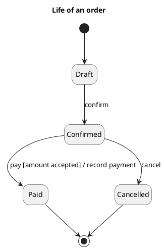
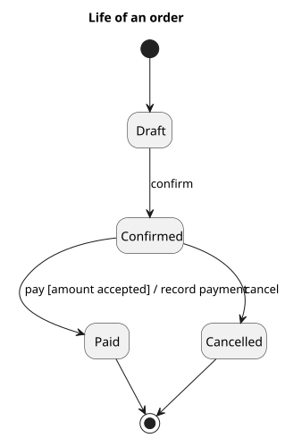

<p align="right">Language:&emsp; <a href="states-v1.es.md" style="vertical-align:middle"></a></p>

[🏠 UML Diagrams](../../../README.md) / [Generate a UML diagram](../SKILL.md)

# UML 1 statechart diagram

Source: OMG UML 1.5, statechart. In UML 2 the diagram is called a state machine.

## Question it answers

What life a single object goes through, and which event makes it change.

## Diagram that is easy to read

A guide for choosing what to draw when the user leaves it open. It never removes what the user asked for or approved (see Fidelity in the skill).

One object, three to six states, an initial state and a final state. Each transition reads `event [guard] / action`. No orthogonal regions: if two parts change at once, they are two machines.

## Notation for this version

- State, initial state, final state, and transition.
- Label `event [guard] / action`.
- One simple composite state is fine if it groups a sub-life.
- Orthogonal regions and the protocol machine are UML 2. A v1 request does not use them.

## Render

PlantUML draws the statechart natively.

## Template

`../assets/states-v1.puml`. Replace the domain names and keep the shape.

## Example





## Examples

Short command. The command already fixes the diagram, so a few words of domain are enough. The agent fills in what you leave open.

```text
/uml-states-v1 The life of an order.
```

Command. It fixes the diagram. The rest is the domain.

```text
/uml-states-v1 An order: draft, confirmed, paid, and cancelled. From confirmed it moves to paid only if the amount is accepted, and the payment is recorded.
```

Prompt. The sentence names the diagram, and the skill chooses this reference.

```text
Draw the UML 1 statechart of an order: draft, confirmed, paid, and cancelled. From confirmed it moves to paid only if the amount is accepted, and the payment is recorded.
```

## Done

- The drawing answers what life a single object goes through, and which event makes it change. The title states that question.
- States, an initial state, a final state, and transitions use the label `event [guard] / action`. Orthogonal regions and a protocol machine are absent.
- Every element the user asked for or approved is in the source. The guide added something only where the user left it open, and the Guide line says so.
- Render is a native statechart. The delivery does not call it an approximation.
