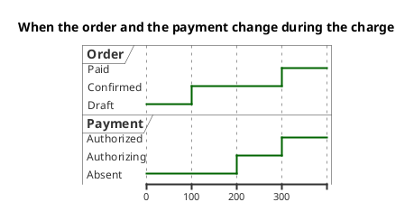

<p align="right">Idioma:&emsp;<a href="timing-v2.md" style="vertical-align:middle"></a> </p>

[🏠 UML Diagrams](../../../README.es.md) / [Generar un diagrama UML](../SKILL.es.md)

# Diagrama de tiempos UML 2

Fuente: OMG UML 2.5.1, anexo A, diagrama de tiempos. No existe en el catálogo v1.

## Pregunta que responde

Cuándo cambia el estado o el valor de unas pocas líneas de vida.

## Diagrama fácil de leer

Guía para elegir qué dibujar cuando quien pide lo deja abierto. Nunca quita lo que pidió o aprobó (véase Fidelidad en el skill).

Dos o tres líneas, el tiempo de izquierda a derecha, estados con nombre. Pocos cambios. Úsalo cuando la pregunta es el instante del cambio, no la lista de mensajes.

## Notación de esta versión

- Línea de vida y estado o valor a lo largo del eje del tiempo.
- Mensajes entre líneas solo si explican un cambio.
- Restricciones de duración solo si el pedido da números.
- Si la pregunta es quién llama a quién, el diagrama es el de secuencia.

## Renderizado

PlantUML dibuja este diagrama de forma nativa con `robust` y marcas de tiempo `@`.

## Plantilla

`../assets/timing-v2.puml`. Sustituye los nombres del dominio y conserva la forma.

## Ejemplo




## Ejemplos

Comando corto. El comando ya fija el diagrama, así que bastan unas palabras del dominio. El agente completa lo que dejas abierto.

```text
/uml-timing-v2 An order being paid.
```

Comando. Fija el diagrama. El resto es el dominio.

```text
/uml-timing-v2 The order moves from draft to confirmed and then to paid, and the payment moves from absent to authorizing and to authorized on that last stretch.
```

Frase. La oración nombra el diagrama y el skill elige esta referencia.

```text
Draw a UML 2 timing diagram: the order moves from draft to confirmed and then to paid, and the payment moves from absent to authorizing and to authorized on that last stretch.
```

## Terminado

- El dibujo responde cuándo cambia el estado o el valor de unas pocas líneas de vida. El título enuncia esa pregunta. No es una secuencia de quién llama a quién.
- Las líneas de vida muestran estado o valor a lo largo del eje del tiempo. Los mensajes aparecen solo si explican un cambio. Una restricción de duración aparece solo si el pedido dio números.
- Cada elemento que se pidió o se aprobó está en la fuente. La guía añadió algo solo donde se dejó abierto, y la línea `Guide` lo dice.
- El render es PlantUML nativo `robust` con marcas de tiempo `@`. La entrega no lo llama aproximación.
