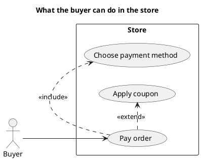
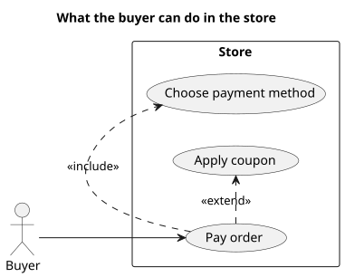

<p align="right">Idioma:&emsp;<a href="use-cases-v1.md" style="vertical-align:middle"></a> </p>

[🏠 UML Diagrams](../../../README.es.md) / [Generar un diagrama UML](../SKILL.es.md)

# Diagrama de casos de uso UML 1

Fuente: OMG UML 1.5, diagrama de casos de uso.

## Pregunta que responde

Quién usa el sistema y para qué metas.

## Diagrama fácil de leer

Una guía para elegir qué dibujar cuando la persona lo deja abierto. Nunca quita lo que la persona pidió o aprobó (ver Fidelidad en el skill).

Actores fuera de un rectángulo de sistema. De tres a seis elipses. «include» cuando el caso siempre reutiliza otro. «extend» cuando la variación es opcional. El flujo paso a paso no va dentro de la elipse.

## Notación de esta versión

- Actor, caso de uso y límite del sistema.
- Asociación de actor a caso.
- «include», «extend» y generalización.
- El texto del caso de uso lo escribe el plugin `plugin-project-manager`. Este diagrama muestra solo actores, límites y metas.

## Renderizado

PlantUML dibuja este diagrama de forma nativa.

## Plantilla

`../assets/use-cases-v1.puml`. Sustituye los nombres del dominio y conserva la forma.

## Ejemplo





## Ejemplos

Comando corto. El comando ya fija el diagrama, así que bastan unas palabras del dominio. El agente completa lo que dejas abierto.

```text
/uml-use-cases-v1 A buyer paying an order.
```

Comando. Fija el diagrama. El resto es el dominio.

```text
/uml-use-cases-v1 The buyer pays an order. Paying always includes choosing the payment method, and it is optionally extended by applying a coupon.
```

Frase. La oración nombra el diagrama, y el skill elige esta referencia.

```text
Draw a UML 1 use case diagram: the buyer pays an order. Paying always includes choosing the payment method, and it is optionally extended by applying a coupon.
```

## Terminado

- El dibujo responde quién usa el sistema y para qué metas. El título enuncia esa pregunta.
- La notación es actor, caso de uso y límite del sistema, con asociación de actor a caso, «include», «extend» y generalización. El texto del caso de uso no está.
- Cada elemento que la persona pidió o aprobó está en la fuente. La guía añadió algo solo donde la persona lo dejó abierto, y la línea Guide lo dice.
- El renderizado es PlantUML nativo. La entrega no lo llama aproximación.
