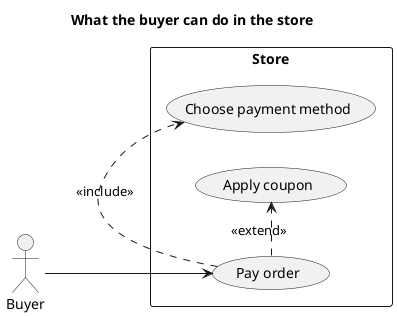

<p align="right">Idioma:&emsp;<a href="use-cases-v2.md" style="vertical-align:middle"></a> </p>

[🏠 UML Diagrams](../../../README.es.md) / [Generar un diagrama UML](../SKILL.es.md)

# Diagrama de casos de uso UML 2

Fuente: OMG UML 2.5.1, anexo A, diagrama de casos de uso. El marco puede llevar el encabezado uc.

## Pregunta que responde

Quién usa el sistema y para qué metas.

## Diagrama fácil de leer

Guía para elegir qué dibujar cuando quien pide lo deja abierto. Nunca quita lo que pidió o aprobó (véase Fidelidad en el skill).

Actores fuera del sujeto. De tres a seis elipses. «include» para la reutilización obligatoria y «extend» para una variación opcional. Sin pasos del flujo dentro de la elipse.

## Notación de esta versión

- Actor, caso de uso y sujeto (el límite).
- Asociación, «include», «extend» y generalización.
- El encabezado de marco `uc` pertenece a UML 2. PlantUML no dibuja ese marco; el título ocupa su lugar y la entrega lo dice.
- El texto del caso de uso pertenece a plugin-project-manager.

## Renderizado

PlantUML dibuja actores, casos y relaciones de forma nativa. El marco con encabezado uc no se dibuja; el título lo sustituye y eso hay que decirlo.

## Plantilla

`../assets/use-cases-v2.puml`. Sustituye los nombres del dominio y conserva la forma.

## Ejemplo




## Ejemplos

Comando corto. El comando ya fija el diagrama, así que bastan unas palabras del dominio. El agente completa lo que dejas abierto.

```text
/uml-use-cases-v2 A buyer paying an order.
```

Comando. Fija el diagrama. El resto es el dominio.

```text
/uml-use-cases-v2 The buyer pays an order, always chooses the payment method, and may extend the payment with a coupon.
```

Frase. La oración nombra el diagrama y el skill elige esta referencia.

```text
Draw a UML 2 use case diagram of the store: the buyer pays an order, always chooses the payment method, and may extend the payment with a coupon.
```

## Terminado

- El dibujo responde quién usa el sistema y para qué metas. El título enuncia esa pregunta.
- La notación es actor, caso de uso y sujeto, con asociación, «include», «extend» y generalización. El texto del caso de uso no está.
- La entrega dice que el marco `uc` no se dibuja y que el título ocupa su lugar.
- Cada elemento que se pidió o se aprobó está en la fuente. La guía añadió algo solo donde se dejó abierto, y la línea `Guide` lo dice.
